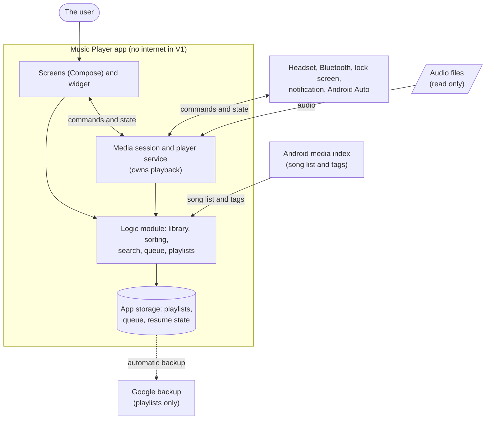

# Technical Design: Music Player

| | |
|---|---|
| Status | V1 agreed 2026-10-30 (sections 1 to 5.1 and 15 on 2026-10-26, the rest on 2026-10-30). V1.1 (5.8 and its rows elsewhere): Draft 2026-11-03, four decisions agreed, the rest proposals. Details that depend on measurement stay provisional (section 15) |
| Last updated | 2026-11-06 (V2: 5.9, merged from the splitter's own folder, and the sections it touches) |
| Owners | The user decides; Claude drafts |
| Inputs | docs/Requirements.md (Agreed), docs/UX Design.md (Agreed), docs/mockups/index.html |
| Feeds | docs/Stories and Test Plan.md (drafted 2026-10-30) |

> **How we use this file.** We go through the sections in the order in section 0, one at a time. For each: Claude drafts it with one recommendation and the runner-up, the user decides, then the section is marked `Agreed` and a row is added to the decision log (section 19). Nothing here is a decision until its status says Agreed. Anything that can only be learned by running something (timings, the test phone, Android Auto, the user's real files) is an unknown with a check and a fallback in section 15, not an assumption. The splitter (V2) is designed in 5.9.

## 0. Walk-through order and section status

| Step | Section | Why this order | Status |
|---|---|---|---|
| 1 | 1 Overview, 2 Constraints and sizing | Everything is sized from these numbers | Agreed 2026-10-26 |
| 2 | 15 Unknowns, checks and milestones | Requirements rest on unchecked assumptions (A-1 to A-4, A-7). The user chose no separate spikes: each is checked in the story that first needs it | Agreed 2026-10-26 |
| 3 | 3 Technology choices | Player library, database, tag reading and pinyin are chosen now and revisited if a story's check fails | Agreed 2026-10-26 |
| 4 | 4 Architecture and modules | Boundaries between logic, Android shell and the media service | Agreed 2026-10-26 |
| 5 | 5.1 Library and metadata | Depends on the checks for A-1 and A-2 (section 15) | Agreed 2026-10-26 |
| 6 | 5.2 Sorting and search | Depends on the check for A-7 (section 15) | Agreed 2026-10-30 |
| 7 | 5.3 Playback, queue and playlists | The queue is separate from playlists (decided in the UX design) | Agreed 2026-10-30 |
| 8 | 5.4 Resume state | Depends on 5.3 | Agreed 2026-10-30 |
| 9 | 5.5 Media session, widget and Android Auto | Depends on the check for A-3 (section 15) and 5.3 | Agreed 2026-10-30 |
| 10 | 5.6 Sleep timer and interruptions | Depends on 5.3 | Agreed 2026-10-30 |
| 11 | 6 Data model and persistence | Depends on 5; includes the backup check for A-4 | Agreed 2026-10-30 |
| 12 | 8 Background work and permissions | Foreground service, notification permission | Agreed 2026-10-30 |
| 13 | 10 Failure handling, 11 Security and privacy | Failure table and the no-internet rule, once the pieces exist | Agreed 2026-10-30 |
| 14 | 12 Performance, 13 Testing | Budgets and tests for what is now designed | Agreed 2026-10-30 |
| 15 | 14 Build, CI and release | Free tooling, signing, Play | Agreed 2026-10-30 |
| 16 | 7, 9, 16 to 18 | 7 External services: none in V1; V1.1 adds one (row 18). 9 Interfaces. Limitations, traceability, risks | Agreed 2026-10-30 |
| 17 | 5.7 Playlist export and import | Designed 2026-11-06 | Built in G1 |
| 18 | 5.8 Automatic song details (V1.1), with the V1.1 rows of 2.2, 3, 4.4, 6, 7, 8, 9, 10, 11, 12, 15 to 18 | The riskiest unknowns first (fingerprint, file writes), then plumbing | Decisions agreed 2026-11-03 (fingerprint, file access, tag writer, scheduler); the HTTP client and the thresholds are proposals; constants provisional |
| 19 | 5.9 Splitting a long MP3 (V2), with the V2 rows of 10, 13, 15, 17 to 19 | Built and in use; the analysis thresholds are provisional | Agreed in principle 2026-11-05, built by 2026-11-06 |

## 1. Overview

Music Player is one Android app that plays the MP3 files on the phone. It has two parts: a small **logic module** that decides everything that does not need Android (the library model, sorting and pinyin keys, search, the queue, playlists, the remembered state), and an **Android shell** that shows the screens in the UX design and talks to the system (the media index, the media session that serves the notification, the lock screen, the widget and Android Auto, and the player). The single most important idea is that **one media session owns playback**: the phone screens, the widget, the notification, headset buttons and the car are all only remote controls for that one session, so they can never disagree.



## 2. Constraints and sizing

### 2.1 Fixed constraints (from the requirements)

- Android 13 (API 33) and newer, phones only; the real test phone runs Android 13 (NFR-8).
- Only MP3 files on the phone are played; no streaming (Requirements section 2).
- No internet permission in V1; nothing leaves the phone (R-18, NFR-4).
- Zero ongoing cost: free and open-source tools and libraries only; the Google Play developer fee is the one accepted payment (NFR-7).
- The user's music files are never changed, moved or deleted by the player (Requirements section 11); the tag writer (5.8), the splitter's `SongWriter` (5.9) and the user's own delete (`SongDeleter`, 5.3, R-50) are the exceptions, each in its own package.
- Android Auto, widget, notification and headset control are part of V1 (R-9, R-16, R-24).
- Process: Claude writes the product code and the tests; the user decides and runs the device checks (the project's working rules).

### 2.2 Sizing table

| Quantity | Value | Source | Consequence for the design |
|---|---|---|---|
| Songs in the library | 2,000 designed for; 5,000 must still work | NFR-2 | The whole library fits in memory (about 1 KB per song, 5 MB at 5,000). Lists need no paging; they use lazy lists. Search is an in-memory filter. |
| Playlists | up to 100, each up to 500 songs (50,000 entries at most) | NFR-2 | Stored in a local database with an explicit order; reordering rewrites at most 500 positions in one transaction. |
| Queue length | up to the whole library (5,000) when "Play all" | R-6, NFR-2 | The queue is stored as a list of song ids (about 40 KB at 5,000), not as full objects; the player is given items in a window. To measure: building a 5,000-item queue (budget 500 ms, section 2.3). |
| Remembered state (R-11) | one record plus the queue ids, under 50 KB | R-11 | Written whenever the song or queue changes, not every second; position is saved on pause and every 3 seconds while playing (5.4: R-11 allows 5 s after a kill). |
| Backup payload | playlists only: at most 50,000 rows, about 5 MB | R-17 | Under Android's 25 MB Auto Backup limit per app. Backup runs about nightly, on Wi-Fi, when the phone is idle and at least 24 hours since the last (official documentation, read 2026-10-25), so a playlist made today may not be backed up if the phone is lost tomorrow. Recorded as a known limitation (section 16). |
| Cover art in memory | 48 dp thumbnails (about 80 KB decoded each); Now Playing cover 280 dp (about 3 MB decoded) | UX design | Thumbnails come from a bounded cache (24 MB, built in A4); the large cover is decoded once per song. Covers are never stored by the app. |
| Sort keys | one per song and title (pinyin for Chinese), a few dozen bytes | R-25 | Computed at scan time and kept with the song, not recomputed per sort. |
| Android Auto list lengths | Official: at most 4 root tabs (hint, default 4), root children must be browsable, `page`/`pageSize` not supported in `onGetChildren`. Items per list: no official number found; forums report 200 to 600 | R-16 | Browse lists must be capped by the app (a "letter" level for Songs) rather than paged; the cap is measured in the Desktop Head Unit and on the user's car (section 15, A-3). Official source: developer.android.com/training/cars/media (read 2026-10-26). |
| Memory during playback | proposal: at most 150 MB for the process | no requirement; not set by the user | To measure on the test phone with `dumpsys meminfo` (section 12). Open question for the user (section 18). |
| Library scan | to measure; proposal at most 3 seconds for 2,000 songs | NFR-1 (5 s from opening to audio) | The Library must show from a local copy at once and refresh in the background (decided in 5.1), so the scan is not on the path to the first sound. |
| V1.1 fingerprint input | The first 120 seconds of one song at a time: mono, 11,025 Hz, 16-bit, about 2.6 MB of audio in memory; the fingerprint is a few KB | R-19 | One song at a time; the buffer is released after each. Decoding speed is to measure (section 15, P5) |
| V1.1 lookup volume | Up to 2,000 requests for a first pass (one per song); at most 1 request per second, while the service allows 3 | R-19, 7 | About 35 minutes of requests for 2,000 songs, but the decoding and fingerprinting of up to 5 s per song (proposal) makes a first pass about 3 hours in all, spread over background runs; one worker, so concurrency is 1 |
| V1.1 file writes | One song at a time; temporary space up to twice the file (the new copy and the original backup): 10 to 20 MB for a 5 to 10 MB song; an unsplit compilation of hundreds of MB is never rewritten | R-27 | Writing is refused, and the details stay in the app, when free space is under `MIN_FREE_FACTOR` (3) times what is backed up (the tag for an in-place write, the whole file for a rewrite), or a rewrite would exceed `MAX_REWRITE_BYTES` (50 MB); a tag larger than `MAX_TAG_BYTES` (16 MB) is not handled |
| Device baseline | the test phone (a mid-range phone); emulator for correctness only | NFR-1, NFR-8 | Speed and memory figures count only from the phone (section 12). |

### 2.3 Hot paths

| Hot path | Why hot | Budget | How measured |
|---|---|---|---|
| Cold start to audio playing | The user's 5-second criterion (NFR-1) | 5 s from process start to sound, for the resumed song or one tap on a visible song | Timestamps logged without content in a debug build (process start, library shown, player ready, first audio), read on the test phone |
| Search as you type | Runs on every keystroke at 2,000 to 5,000 songs | Results within 100 ms per keystroke (proposal) so that NFR-1's 1 second is met with margin | Unit benchmark in the logic module on 5,000 generated songs |
| Scrolling a long list | Cover loading must not stall the list | No dropped frames at normal scrolling on the test phone (proposal: under 5 % of frames over 16 ms) | Android's built-in frame statistics on the test phone |
| Library scan and refresh | Runs at start and on every return to the front | At most 3 s for 2,000 songs, in the background (proposal) | Timed in the library story on the test phone |
| Sorting by title with pinyin | Runs on every sort change | At most 200 ms for 5,000 songs (proposal) | Unit benchmark |
| Building a large queue | "Play all" on 5,000 songs | At most 500 ms to the first sound (proposal) | Timed on the test phone |
| Next and previous | NFR-1 | 0.5 s | Timed on the test phone |
| Widget and notification updates | Battery (NFR-10) | Only on a change of song or play state; never on a timer | Review plus battery statistics |

## 3. Technology choices

Agreed 2026-10-26 (the user approved Kotlin, Compose, Media3, `MediaStore`, Room, Coil and hand-written injection; the dependency yes required by NFR-7 is given for Media3, Room and Coil). All are free and open source (Apache 2.0) per NFR-7; exact versions are picked together in the first story from the official compatibility tables. Each row is revisited if a check in section 15 fails.

| Need | Recommendation | Runner-up and why it lost |
|---|---|---|
| Language and UI | Kotlin with Jetpack Compose (declarative, state-driven: closest to React) | Views with XML layouts: the older model, more code for lists and state, and the UX design's lists, sheets and handle are simpler in Compose. Flutter or React Native: the media session, notification and Android Auto are native Android anyway, so a bridge would add a layer for no gain |
| Playback and media session | Media3 (`ExoPlayer` + `MediaLibraryService`): one library gives the player, the foreground service, the notification, audio focus, pause on unplug, headset buttons and the Android Auto browse tree | Platform `MediaPlayer` with `MediaBrowserServiceCompat`: we would hand-write the queue, audio focus, noisy-unplug handling and notification, which are exactly the R-9 behaviours that Media3 already does |
| Finding songs | `MediaStore.Audio` (Android's media index; permission `READ_MEDIA_AUDIO`). Think of it as a system-wide read-only database of files and tags that Android keeps current | Scanning folders ourselves through the file picker: needs a folder grant, and the user ruled out a folder-picker fallback (R-2) |
| Tags and Chinese text | Whatever `MediaStore` gives; our own tag reader only if the A-2 check fails | A tag-reading library from the start: extra dependency and cost check for a problem that may not exist |
| Local database | Room (an ORM over SQLite, like EF or Hibernate in miniature; a file in the app's private storage, no network): playlists with order, queue ids, resume state and the small settings (tab, sort, shuffle, repeat); transactions give atomic writes | Plain JSON files: no atomic per-key write, and reordering a 500-song playlist would rewrite a whole blob (working agreement, Concurrency). Jetpack DataStore for the small settings: rejected by the user to keep one store |
| Cover images | Coil (Compose-first image loader with memory cache) | Glide: heavier and View-first. Using Media3's artwork only: does not cover the library lists |
| V1.1 fingerprint | A Kotlin port of Chromaprint's default algorithm in `core` (the audio is decoded with Android's `MediaExtractor` and `MediaCodec`; no dependency). Chromaprint's own code is MIT, but its repository also contains parts of FFmpeg (LGPL 2.1), which is why the project calls the whole LGPL 2.1 (its `LICENSE.md`, read 2026-11-03); the port is written from the MIT code with its own FFT, so it takes none of the FFmpeg parts. Verified against the official `fpcalc` tool (5.8, section 15) | The real C++ library through the NDK: exact, but needs the NDK and CMake on the user's PC, cannot be compiled or tested in WSL, adds native crash risk, 16 KB page-size alignment and LGPL packaging duties. The prebuilt `fpcalc-android` wrapper: old (Chromaprint 1.4.3, FFmpeg 3.3.6), run as a separate process, small third-party project |
| V1.1 lookup service | AcoustID (fingerprint to recording) with MusicBrainz data through AcoustID's `meta` parameter; no direct MusicBrainz call (so no contact User-Agent and a single rate limit). Terms read 2026-11-03 (section 7); non-commercial personal and family use is settled (Requirements decision log) | MusicBrainz text search: needs a trustworthy title from the file name, which the user ruled out |
| V1.1 HTTP and JSON | The platform's `HttpURLConnection` for one POST to one host, and a small JSON reader in `core` (`AcoustId.parseAnswer`): no dependency, and the parser is tested on the plain JVM | OkHttp (Apache 2.0): nicer API, a dependency for no gain here. Android's `org.json` for the parsing: not available to the JVM tests without a test-only library, and its licence is odd |
| V1.1 tag writing | Our own ID3v2 reader and writer in `core` with a recovery journal (5.8) | mp3agic (MIT): unmaintained by its own statement, behaviour on save and on Chinese text unverified, and a journal would still be ours |
| V1.1 write access to the user's files | The Media management special permission (`MANAGE_MEDIA`, Android 12 and newer), with `createWriteRequest` dialogs as the fallback | Dialogs only: they appear only while the app is on screen, so no automatic background writing |
| V1.1 background work | WorkManager (Apache 2.0, already in the app through Glance) with a network constraint | Our own foreground service: needs the notification permission, a service type that Android 15 limits to about 6 hours a day, and our own network and restart handling |
| Pinyin | Chosen in the sorting story after reading licences (section 15, A-7) | Not decided |
| Dependency injection | By hand (constructor passing) | Hilt or Koin: more tooling and annotation processing for an app this size |
| Build | Gradle (Kotlin DSL) with the project wrapper | None: the standard for Android |

## 4. Architecture and modules

Agreed 2026-10-26.

### 4.1 Modules

Two Gradle modules (a module is a separately compiled project inside the repository, like a Maven or npm workspace package):

| Module | Kind | Contains | Must not contain |
|---|---|---|---|
| `core` | Pure Kotlin/JVM | Song and playlist models; sort keys; search and Simplified/Traditional matching; queue building (order, shuffle order, "play next"); playlist rules (add, move, remove); resume-state model; sleep-timer logic; the interfaces the shell implements (`LibrarySource`, `PlaylistStore`, `ResumeStore`, `Clock`) | Anything from `android.*` or `androidx.*` |
| `app` | Android application | Compose screens and the widget; the playback service (Media3 session, player, notification, Android Auto browse tree); `MediaStore` reader; Room database; Coil; manifest and permissions; the wiring by hand | Business rules that can be written without Android (they go in `core`) |

**Recommendation: two modules.** All of Claude's tests for the rules (shuffle, repeat, sort order, search, playlists, sleep timer) then run on the plain JVM in seconds with no emulator, which is the "default suite offline and fast" rule. The cost is a few interfaces between the modules.
**Runner-up: one module with packages.** Less setup for someone new to Android, but nothing stops an `android.*` import from creeping into the rules, and every test would need the Android test tooling or a device.

### 4.2 Runtime view (teaching note)

- **Activity** is the screen host (the one window of the app); Compose draws inside it. Android may destroy and recreate it at any time (rotation, memory), so it holds no state that matters.
- **Service** is a background component with no screen. The playback service (`MediaLibraryService`) runs while music plays and owns the player and the media session. Think of it as a daemon with a tray icon; the screens, the widget, the notification, headsets and Android Auto are all clients of its session.
- The Activity talks to the service through a **`MediaController`**, a remote control for the session. The UI never holds the player.
- One process, one main thread for UI. File and database work run on **coroutines** (Kotlin's lightweight async tasks; like `async/await`) on background dispatchers. Screens observe data as **Flows** (streams of values; like an RxJS observable or a Go channel) and redraw when it changes.
- Dependency wiring is a hand-written `AppContainer` created in the `Application` class (the object Android creates once per process, like a `main()` that outlives the windows).

### 4.3 Where the queue lives (decision for 5.3, flagged here)

Media3's player keeps its own playlist and already has shuffle and repeat modes. The risk is two queues that disagree. Direction for 5.3: the player's list is the live queue; `core` decides what list to give it and in what order, and what to save. This is not decided until 5.3.

### 4.4 Architecture rules and the tests that enforce them

| Rule | Test |
|---|---|
| `core` imports nothing from `android.*` or `androidx.*` | `core` is built with the plain Kotlin/JVM plugin, so it cannot compile such an import (the build is the enforcement; no extra test) |
| V1 has no internet access (NFR-4, R-18) | Until the V1.1 lookup is built, a test reads the merged manifest of the release build and fails if it declares `INTERNET` (a dependency could add it). From then on: the manifest may declare it, a source scan fails if any file outside `app.songplayer.details.net` uses `java.net`, `javax.net` or `HttpURLConnection`, and a unit test with a fake client shows that `DetailsService` makes no request while `detailsEnabled` is off |
| The tag writer cannot change audio (R-27) | `core`'s ID3 code has no `android.*` import (the build enforces it) and its tests assert that the bytes after the tag are identical before and after, for every shape in 5.8 |
| Only the playback package touches the Media3 player; screens use `MediaController` | A source-scan test in `app` fails if a file outside the playback package imports `androidx.media3.exoplayer` |
| No song title, artist, file name or playlist name in logs (NFR-4) | All logging goes through one `Log` wrapper that takes codes, not strings; a source-scan test fails on direct `android.util.Log` use elsewhere (detail in section 11) |

## 5. Core domain

### 5.1 Library and metadata

Agreed 2026-10-26. Requirements: R-1, R-2, R-3, R-4, R-12, R-22.

**Decisions made by the user (2026-10-26):** the app keeps a copy of the songs' *metadata* (never the audio) in its own database and reconciles it with Android's media index in the background; songs that no longer exist are removed from the copy; a song is identified by its path.

**Song key.** `<volume>:<relative path><file name>`, for example `external_primary:Download/Songs/a.mp3`. It is the identity used by the cache, playlists, the queue and the "Can't play" mark. A moved or renamed file is a different key (limitation, section 16). Runner-up: an audio fingerprint, which survives moves but needs the whole file read and a hashing dependency; rejected for a library whose only metadata is file names. Playlist entries also store file name, size and duration, so an entry whose key is gone can be relinked when exactly one library song has the same file name and size (rule to confirm in 5.3 and section 6).

**Stored fact: `song` rows (Room).** One row per MP3 that the media index lists.

| Field | Source | Note |
|---|---|---|
| key (primary key) | built from volume, relative path, display name | |
| mediaStoreId | media index `_ID` | Used only to build the playable URI; looked up from the key at play time, never stored elsewhere |
| title, artist, album | media index tags | Missing values stored as null (the index's `<unknown>` is converted to null). Display fallbacks (R-3) are applied when reading, not stored |
| durationMs, sizeBytes, dateAddedSec, dateModifiedSec | media index | `dateAddedSec` drives "Recently added" (R-22) |
| sort and search keys | computed by `core` at sync | Added in 5.2 |

Writer: the sync, only. Readers: the screens (as a Flow), the queue builder, the Android Auto tree. A sync applies its changes in one Room transaction, so a kill mid-sync leaves the old cache and a rerun is safe. Loss costs a rescan.

**Stored fact: `play_failure` rows.** `key`, `failedAt`. Written by the playback service when a play attempt fails; read by every list that shows "Can't play". Kept apart from `song` so the mark still shows on a playlist entry whose song has left the library (R-12). Cleared when that key plays successfully, or when a sync sees the file's size or modified time change.

**Query.** `MediaStore.Audio` on all external volumes, `MIME_TYPE = audio/mpeg` (R-1d). Whether to also require `IS_MUSIC` is decided by the A-1 check on the test phone. Pending and trashed items are excluded by the index's defaults. The column names above are from memory of the Android API, not yet checked against the reference; the library story confirms them.

**Sync (pure logic in `core`).** `LibraryDiff.diff(cache, scan)` returns added, removed and changed songs; `core` also holds the display fallbacks. `app` implements `LibrarySource.scan()` and applies the plan.
- Triggers: app start, return to the front, the manual refresh (R-1b, R-1c), and a change notification from the media index while the app is in front.
- One sync at a time; a request during a sync causes exactly one rerun afterwards.
- It does a full query and diff, not an incremental one. Runner-up: ask the index only for rows changed since the last sync (`GENERATION_MODIFIED`); rejected because 5,000 rows is small, and it adds state that can go wrong when the index is rebuilt.
- "N new songs found" (R-22) is a one-time result of a sync, not stored. The first sync into an empty cache says nothing (proposal), so a fresh install does not announce 2,000 new songs.
- Permission refused: no query, the screens show the R-2 state, and the cache is kept untouched, so allowing again does not look like a flood of new songs.
- Runs off the main thread; logs counts and error codes only (NFR-4).

| Failure | Class | Typed error | Behavior and message | Test |
|---|---|---|---|---|
| Permission refused or revoked | Expected | `LibraryError.PermissionDenied` | Empty state with explanation, "Try again", "Open Settings" (R-2); cache kept | Fake source throws; screen state is the R-2 state; cache unchanged |
| Index query fails | Core data | `LibraryError.QueryFailed` | Cache stays on screen; plain message "Couldn't refresh your music. Try again" with a retry; error code logged | Fake source throws; cache intact; error surfaced |
| Row with null or odd columns | Expected | none | Treated as missing tags; file name used as title | Diff test with null fields |
| App killed during sync | Transient | none | Old cache remains; next start syncs again | Transaction test: fail halfway, nothing applied |
| Two syncs requested together | Expected | none | Run once, then once more | Concurrency test forcing out-of-order completion |
| Song gone from the phone | Expected | none | Removed from `song`; its playlist entries stay, marked (R-12) | Diff test; `play_failure` kept |

Hot path: query and diff for 2,000 songs in 3 s on the test phone, measured in the library story. Check A-1 (all MP3s listed) and A-2 (readable Chinese; with the user's files carrying no tags, file names are what must be readable) run in that story on the test phone.

### 5.2 Sorting and search

Agreed 2026-10-30. Requirements: R-5, R-25; screens in UX Design 4.1 and 4.3.

**Albums and artists are views, not tables.** They are grouped from `song` rows when read (about 5,000 rows, so cheap). Album group = the folded album name only; so two artists' "Greatest Hits" would merge, and every song with no album tag falls into one "Unknown album" group (limitation, section 16; to revisit with the user's real files). An album's artist line is the one artist its songs share (whole tags compared after folding, not split), else "Various artists"; so an album with songs tagged "A, B" and "A" shows "Various artists". Artist group = one per individual name: `Artists.names` splits a tag on `,` `，` `、` `;` `；` (not on `&`, `/` or "feat."), and a song joins the group of each name, counted once per group; a band name with a comma splits (the known limit, section 16). A tag with no name is the shared "Unknown artist" group.

**One interface hides the text work.** `core` defines `TextKeyer` (`version`, `sortKey(text)`, `searchFold(text)`); all ordering and matching rules live in `core` and are tested with a fake keyer. The real keyer needs the Chinese data, so it is chosen in the sorting story (section 15, A-7):
- **Recommendation: Android's built-in ICU** (`android.icu.text.Transliterator`, ids `Han-Latin` for pinyin and `Traditional-Simplified`). It is part of the phone's operating system: no dependency, no download size, no licence to clear (NFR-7). It lives in `app` and implements the `core` interface. Unknown until the check: whether both transliterators exist and give the right order on the test phone; its tests run on the emulator and the phone, not on the plain JVM.
- **Runner-up: TinyPinyin (or pinyin4j) plus a bundled Traditional-to-Simplified table such as OpenCC's.** Pure Java, so it can sit in `core` and be tested on the JVM, and it behaves the same on every phone; but it adds a dependency, size and a licence to read (pinyin4j forks differ: BSD, GPL, Apache). It is the fallback if ICU fails the check.
- Both pick one reading per character (no word context), so a few polyphone titles (for example 重庆, 长) can sort slightly off. Accepted for sorting; search does not use pinyin.

**Stored sort and search keys** (derived, but kept so a sort never recomputes them; section 2.2): on each `song` row, `sortTitle`, `sortArtist`, `sortAlbum` and `searchText` (folded title, artist, album and file name joined). They are written by the sync, and by one recompute pass when the stored `keyerVersion` setting differs from the keyer's `version` (the ICU version is part of it, so an operating-system update cannot leave stale keys). The pass is one transaction.

**Sorting rules (`core`).**
- Sort keys are lowercase ASCII for Latin and pinyin, with a space between syllables (so "xi an" sorts before "xian"). Letters sort first, then digits, then any other first character; the last two form the "#" bucket after Z, as the UX design's handle shows ("A to Z, then #"). Ties are broken by the song key, so order is stable; sorting by artist orders by title within one artist before the key.
- Songs and Albums: Title, Artist, Recently added (newest first, from `dateAddedSec`). The title shown when the tag is missing is the file name, so the sort key is built from what is shown.
- The fast-scroll letter is the first character of the sort key (A to Z, or "#"); for Recently added it is the month.
- Sorting runs in memory on a background dispatcher; budget 200 ms for 5,000 songs. Reversing is the default list read backwards (`sorted(order, reversed)`), so it costs no second sort and its ties stay deterministic; the fast-scroll sections are computed from the list as shown.

**Search rules (`core`).**
- The query is folded the same way as `searchText` (lowercase, width folding, Traditional to Simplified). It is split on spaces; a song matches when every part is contained in its `searchText`. Albums match on album name, artists on artist name. No pinyin matching (decided).
- Results are the three groups of the UX design (Songs, Albums, Artists); a tapped song plays with the Songs group as the queue.
- The folded index is held in memory (built from the same Room Flow as the lists, from the stored `searchText` of each song and from the same album and artist groups the Library shows; results are in Title order; the shared unknown-album and unknown-artist groups never match) and filtered on each keystroke; budget 100 ms at 5,000 songs, measured by a unit benchmark. Nothing is searched in the database.

| Failure | Class | Behavior | Test |
|---|---|---|---|
| The device lacks a transliterator or it throws | Non-critical | Fall back to plain lowercase text and code-point order for Chinese; log the code `KEYER_FALLBACK` (no text); the app keeps working with a coarser order | Fake keyer throws; sorting and search still return results |
| Odd input (empty, emoji, unpaired surrogates) | Expected | Keys are built without error; empty text sorts under "#" | Keyer unit tests |
| Kill during the recompute pass | Transient | One transaction: old keys and old `keyerVersion` remain; rerun at next start | Transaction test |
| Search with no matches | Expected | "Nothing found" state (UX B2) | Core search test returns empty groups |

### 5.3 Playback, queue and playlists

Agreed 2026-10-30. Requirements: R-6, R-7, R-8, R-10, R-12, R-13, R-15; screens in UX Design 4.4 to 4.7.

**Who owns the queue (closes the flag in 4.3).** The Media3 player's own item list is the live queue, and Media3's own shuffle and repeat modes are used. `core` decides *which* songs go in, in *what* order, and what to save. There is one queue, so the screens, the notification, the widget and the car cannot disagree.
- **Recommendation: Media3 owns shuffle and repeat.** "Every song once, then stop" (R-7), "turning shuffle off keeps the current song and restores list order" and the three repeat modes are built-in behaviour, and the notification and Android Auto buttons map straight onto them.
- **Runner-up: `core` owns the order** (it pre-shuffles and hands the player an already-ordered list, keeping the original order to undo). It is testable on the plain JVM, but we would rebuild the un-shuffle and the repeat logic that the library already has, and keep two views of the order in step. It is the fallback if the unknown below fails.
- **Unknown, checked in B2 (emulator):** with shuffle on, does "Play next" put the song really next? Result: not by itself, but no custom `ShuffleOrder` class is needed. `core` (`ShuffleRules`) computes the order and `QueueShuffler` hands it to the player through `DefaultShuffleOrder(int[], seed)`; the primary design stands. Also found: with shuffle turned on mid-song, or a new queue set while it is on, Media3 may play the current song in the middle of the shuffled order, so the songs before it never play; the same order fix puts the playing song first (R-7). (The original criterion was: after "Play next" the song plays next, with shuffle on and off, and if it needed more than a small custom order class, switch to the runner-up; it passed without one.)

**Starting a queue (`core`, pure).** `QueueBuilder.fromList(songs, startIndex)` returns the ordered keys; "Play" and "Shuffle" on an album or playlist (UX 4.4) copy the list the same way, and only "Shuffle" turns the shuffle mode on. Tapping a song gives the visible list as the queue (R-6). Building 5,000 items must reach the first sound in 500 ms (section 2.3); the app gives the player all items in one call with a content URI each, built from `mediaStoreId`. If that misses the budget, give it a window of 100 items around the current one and top it up (the plan sized in 2.2).

**Queue edits.** "Play next" inserts after the current item; "Add to queue" appends; "Remove from queue" removes; a tap on a row jumps to it. None of these touch a playlist, and editing a playlist while it plays does not touch the queue (UX decision D-14). Removing the current item and jumping to a row are Media3's own behaviour (tested on the player). `core` holds what Media3 does not do for us, as pure functions that run without Android: `QueueEdit` (where Play next and Add to queue insert) and `ShuffleRules` (the shuffle order with the playing song first, and a song moved right after the playing one or to the end); `QueueShuffler` in `app` applies them to the player.

**Previous and next.** After 3 seconds of the song Previous restarts it, before that it goes to the previous song (UX 4.5). Media3's default for "seek to previous" is 3 seconds; the player applies it to every controller, which B1 checks on the player (emulator test); that the notification, headset and car buttons reach the same call is checked by hand (B1 manual step 3) and in the Android Auto story. The value is the named constant `PREVIOUS_RESTART_MS = 3000`.

**A song that fails to play (R-12).** The playback service handles the player's error: record `play_failure` for that key, then move to the next item (even in repeat-one), with no message. `core` holds the stop rule, `SkipPolicy.next(consecutiveFailures, queueSize)` → `Skip` or `Stop`: when failures in a row reach the number of songs in the queue, playback stops, so repeat-all over a queue of unplayable songs cannot skip forever. The counter resets on the first song that starts to play, and the same moment clears that song's own mark. Only errors that blame the song count (file gone or unreadable, malformed or undecodable data; `core` `PlaybackErrors`); an audio-output failure, a revoked permission or an unknown error is logged by number, marks nothing and stops, so one fault cannot mark the whole queue. The song marked is the one the error names (the player can report a missing song further down the queue while the current one still plays), not simply the current one; such an upcoming song is marked and taken out of the queue so the current song carries on. Built in B3 as `PlaybackFailures`, a player listener in the playback package; the writes go to a background thread. Repeat one on the last song of the queue, with that song bad, stops because there is no next song to move to (follows from Media3 treating repeat one as off when asked for the next song; not tested).

**Opening a file from another app (R-15).** The activity receives `ACTION_VIEW` with a content URI for `audio/mpeg`. The shell checks that the type is MP3 and the file opens before it replaces the queue; if not, it shows the UX D7 dialog and leaves playback as it was. A file queue holds one item and playback stops when it ends. The file is not added to `song` and its title is the display name from the provider.

**How an opened file is checked and kept (D1).** `FileOpener` asks an `OpenableSource` (the content resolver in the app, a fake in tests) for the type, the display name and the first 8 KB, and `core` `OpenFileRules.check` decides: the type must be `audio/mpeg` (or the provider gives none or a generic one and the name ends in `.mp3`), the bytes must be readable, and they must begin with an ID3 tag or contain a valid MPEG Layer III frame header within those bytes (`Mp3Sniffer`), so a text file renamed to `.mp3` is refused before it can replace the queue. Only `content` addresses are opened: a `file` address from another app could name any path the app can read. The queue key is `file:` and the address (`ExternalFile`), which no library key starts with; the queue entry also keeps the display name (`queue_item.displayName`, so `app.db` is version 4, dropped and rebuilt on the bump as before), and `ResumeRules.validate` keeps such an entry although the library does not have it. If the other app offered lasting access (`FLAG_GRANT_PERSISTABLE_URI_PERMISSION`) the app keeps it for the newest file only; otherwise the saved file fails to play after the temporary access ends and is skipped silently like any unreadable song (R-12). `MainActivity` is `singleTask` and handles the intent in `onCreate` (not again after a rotation, and not when the task is reopened from the Recents list, which brings the original intent back) and `onNewIntent`. The newest request cancels an older one that is still waiting for its provider, so a slow provider cannot finish last and replace the file opened after it; a provider that does not answer in 10 seconds counts as unreadable. A file queue switches repeat off and the setting stays off afterwards (the user's decision, 2026-11-02): the file plays once and stops.

**Stored facts: playlists.** Two tables in a database of their own (6).

| Field | Note |
|---|---|
| `playlist`: id, name, createdAt | Two playlists may share a name (accepted by default, 2026-10-30). A name is trimmed, not empty, at most 100 characters |
| `playlist_entry`: id, playlistId, position, songKey, fileName, sizeBytes, durationMs | `position` is dense, 0 to n-1. A reorder or removal renumbers the affected rows in one transaction (at most 500 rows). Two lists cannot interleave because every playlist change is one transaction |

Writer: the playlist store, only, called from the screens; the rules are `core`'s `PlaylistRules` (add, move, remove, undo of a removal), which take the current list and return the new one. An action names an entry by its id, never by a position, so a screen that drew the list a moment ago cannot move or remove the wrong song; an entry that is already gone is a no-op. `playlists.db` is opened with a helper that never lets Android delete a damaged file (built in C1). Readers: the screens (Flow), `QueueBuilder`, the Android Auto tree. An entry whose key is no longer in `song` stays and shows "Can't play" (R-12).

**Playlist screens (C2).** `PlaylistsViewModel` takes the `PlaylistStore` and the logger (so tests give it a real or a failing store). It reads the lists and the open playlist as flows, and runs every change on the IO thread, one at a time in the order the screen asked (a mutex, so two quick moves cannot swap), then tells the screen on the main thread whether it was saved. A failure is logged as a code (1 for a damaged file, 0 for another reason) and the screen turns the result into words. The screens receive their abilities as one `PlaylistActions` value from the root, never the database. `core` `PlaylistView` holds the rules that need no Android: the rows of an open playlist (each saved entry with the library's song, or none when the song has left the library), the queue "Play" copies (only songs the library has, in order, as a new list), where a tapped row sits in it, the random start of "Shuffle", the wording choice after an add (one song, several, already in), and the drag arithmetic (whole rows of travel, kept inside the list). "Shuffle" asks the player to turn shuffle on before the queue is set (`PlaybackClient.play(..., shuffle = true)`); "Play" never touches the shuffle mode. The queue's source is `PlayingFrom.Playlist` ("Playing from: Playlist"). After each library rebuild the root calls `relinkAll` with the new songs. Dragging a handle moves a row one place for every row-height of travel and saves each move at once; Move up, Move down and Move to top do the same without dragging.

**Relinking (confirms the rule in 5.1).** After each sync, `Relinker` looks at entries whose key is not in the library; if exactly one library song has the same file name and size, the entry's key is updated; if none or more than one, nothing changes. It also runs after a restore to a new phone, where the paths may differ (R-17, A-4). A song can be in a playlist only once: adding it again changes nothing and shows the snackbar "Already in Driving" (the user's decision, 2026-10-30).

| Failure | Class | Typed error | Behavior and message | Test |
|---|---|---|---|---|
| Song fails to play | Expected | none (the player's error number is logged as `PLAYBACK_ITEM_FAILED`; `PlaybackError` is reserved and not thrown) | Mark, skip, no message (R-12). An error that is not the song's fault (audio output, permission, unknown) marks nothing and stops | Real player and real files: `play_failure` written; the next song plays; `PlaybackErrors` unit tests |
| All songs fail, repeat all | Expected | none | `SkipPolicy` returns `Stop` after N failures in a row; paused, no message | Core test with 3 songs, all failing, repeat on |
| Opened file is not an MP3 or cannot be read (or the provider takes over 10 seconds) | Expected | `OpenFileError.NotMp3`, `OpenFileError.Unreadable` | Dialog D7; old queue untouched | Fake provider; queue unchanged |
| Playlist write fails (for example storage full) | Core data | `StoreError.WriteFailed` | Nothing is half-written (transaction); snackbar "Couldn't save the playlist. The phone may be out of space." | Fake DAO throws; list unchanged |
| Playlist entry has no library song | Expected | none | Entry kept, "Can't play" mark | Core test for `Relinker` (one match, none, two) |

**Deleting songs (R-50).** The song menu (`LocalDeleteSongs`, provided by the root like Split and Edit details) and the Library's selection bar hand the chosen songs to the root, which asks its own question (UX Design E7) and only then asks `SongDeleter.request` for `MediaStore.createDeleteRequest` on the songs' media ids (the volume is read from the song key). Android's result comes back to the root: on yes, `PlaylistStore.removeSongs` takes every entry of those keys out of every playlist in one transaction (`PlaylistRules.withoutSongs`, positions kept dense), the library is synced and the message "N songs deleted" is shown; on a refusal nothing changes. If the request cannot be made, nothing is deleted and the message says so (`SONGS_DELETE_FAILED`, a count only). A song that is playing or queued becomes a song that cannot play and is skipped (R-12); the queue is not edited. The names of the songs are never logged (`SONGS_DELETED` carries a count). Trade-off: if the app is killed between Android's yes and the playlist clean-up, the entries stay and show "Can't play" until the user removes them.

### 5.4 Resume state

Agreed 2026-10-30. Requirements: R-11, R-15, R-17 (excluded), NFR-3.

**Stored facts (database `app.db`, section 6).** `resume` is one row: `currentKey` (a library song's key, or `file:` and the address of a file opened from another app), `positionMs`, `shuffleOn`, `repeatMode`, `queueSource` (text label for "Playing from"). `queue_item` has one row per queue item: `position` (the order before shuffling), `songKey`, `displayName` (the name of an opened file; null for a library song), and `shuffleRank` (null when shuffle is off), so shuffle can be restored and also turned off after a restart.

**Writers.** Only the playback service writes them, through `ResumeStore` (built in B4: `ResumeWriter`, a player listener that reads on the player's thread and writes in order on one background thread; the whole queue is rewritten, with the resume row in the same transaction, whenever it or the shuffle or repeat setting changes, which for a 5,000-song queue is one batch insert, not measured yet; a position write is ignored if the queue no longer has that song at that place). The queue is rewritten whole in one transaction with the resume row, once per burst of changes (a new queue, "Play next", "Add to queue", a removal, shuffle or repeat changing); only the position is a single-row write. `resume` is updated on song change, on pause, on the end of playback, when the service is destroyed, and while playing every `POSITION_SAVE_INTERVAL = 3 s`. Section 2.2 had proposed 10 s; R-11 allows 5 s of error after a kill, so the interval must be shorter than 5 s (section 18).

**Restore.** (Built in B4 as `ResumeRestore`: the queue is read and checked against the library off the main thread, then given to the player if the player is still empty, so a tap made before it finished is not overwritten; shuffle order comes back from the saved ranks.) When the service is created it reads `resume` and the queue, gives them to the player *paused and not prepared*, and seeks to the position. The mini player shows the song of the restored player as soon as the controller has connected (built in B4; it does not read the stored row separately, which would only save the few hundred milliseconds of connecting). The widget, which has no player to ask when the app is not running, reads the stored row (built in E1: the song the queue was on, found by a single-key lookup, shown paused). Tapping Play prepares and plays (the 5-second budget of NFR-1 is checked in the playback story). The same path is `onPlaybackResumption` for the widget Play button, headset buttons and the car.

**A file opened from outside.** It becomes the remembered last song (UX D6). Android gives only temporary access to such a URI, so after a restart it may be unreadable; the app asks for a persistable grant and, if there is none, the song fails silently as in R-12. Unknown, checked in the file-open story on the test phone.

| Failure | Class | Behavior | Test |
|---|---|---|---|
| Killed while playing | Transient | Next start restores the song at the last saved position (at most 3 s old), queue, shuffle, repeat | Out-of-order test: position writes racing with a queue replace; last committed state wins |
| Stored current key is not in the library | Expected | Show the nearest valid state: the queue without the song; if the queue is empty, no mini player | Core test on `ResumeState.validate(library)` |
| Queue and `resume` disagree after a crash between two writes | Transient | The queue replace and the `resume` row are written in one transaction, so they cannot disagree | Transaction test |
| `app.db` unreadable | Non-critical | A damaged file is replaced by an empty one by Android itself (built in B4); any other failure to open it (full disk, lock) leaves the file alone and is raised: no resume, library rescans | Corrupt file test (a file that is not a database) |

### 5.5 Media session, widget and Android Auto

Agreed 2026-10-30. Requirements: R-9, R-16, R-24, A-3. Android's "Build media apps for cars" page is read (section 15); the Media3 session guide details, the car quality guidelines, "Distribute to cars" and the voice-action page are still to be read (E3 was written from the Media3 sources instead, which say how a spoken request arrives; the pages stay on the open-items list).

**The service.** `PlaybackService` extends Media3's `MediaLibraryService` and owns the `ExoPlayer` and one `MediaLibrarySession`. The phone screens use a `MediaController`; the notification (Media3's default provider), lock screen, headset buttons, widget and car are controllers of the same session (section 4.2).

**Showing up in the car.** Android Auto's manifest guide (read 2026-11-03) asks for the media service, the `automotive_app_desc` entry, a launcher icon (`android:icon`) and a monochrome attribution icon (`androidx.car.app.TintableAttributionIcon`); a manifest test checks all of them. A build that is not installed from Google Play is hidden in a real car unless Android Auto's developer mode has "Unknown sources" on (README, "Try it in the car").

**Who may connect.** `onConnect` accepts what Media3 calls a trusted controller (this app, the system's media-notification and media-button controllers) and Android Auto's own controller (`session.isAutoCompanionController`); the rule is the `core` function `ControllerPolicy.allows`. The assistant's own controller (Google's app, package `com.google.android.googlequicksearchbox`, accepted only when Android has verified that the package belongs to the caller) is also let in, so that spoken requests reach the session; this list is a recommendation, not yet seen in a car: the runner-up, trusting only Media3's `isTrusted`, is smaller but could silently refuse the assistant. If the car's check shows another package, it is added here. Any other app is refused, so no other app can read the library or control playback (NFR-4). Whether the DHU and the user's car connect through the accepted controller is checked in the Desktop Head Unit; too narrow a list would silently break the car.

**Browse tree (for the car, `core` builds it from the library).** The root is exactly four tabs, the most Android Auto allows: **Playlists, Albums, Artists, Songs** (ids `playlists`, `albums`, `artists`, `songs`). Below them: a playlist, album or artist holds its songs; Songs holds all songs by title. Ids join their parts with a separator character (U+001F) so that a name can contain any text: a song is `<list id><sep><song key>`, which is how a tap knows which list it was in. The UX design's earlier fifth entry "Resume (last played)" was dropped (decision log, 2026-10-30): the car shows the restored last song in Now Playing, and the connect behaviour below resumes it. Android Auto does not page `onGetChildren`, so a list longer than `AUTO_LIST_CAP` (provisional **100**, to be tuned in the Desktop Head Unit and the car) is split: first by first letter (A to Z, #), and a letter with more than the cap into runs of the cap ("A 1-100"). The rule is the pure `core` class `BrowseTree` (`children`, `item`, `queueFor`), unit-tested with 5,000 songs; `CarLibrary` in `app` reads the sorted library for it on its own thread (so a slow browse cannot delay saving the position), keeps the result for 5 seconds because one browse asks several times, and shows an empty library when music access is not granted. The cost of one read for 5,000 songs is not measured yet (the head unit shows whether the car waits too long). Tapping a song makes its list (or letter run) the queue, starting at that song (`onSetMediaItems` resolves the id). With no music the root holds one message, "Open Music Player on your phone to set up your music." (the same when music access was never granted, because the library is then empty). Not yet: list artwork and tab icons (Android Auto prefers monochrome tab icons). The sleep timer and the queue editor are not offered in the car (UX).

**Controls in the car.** Play, pause, next, previous and seek are the session's standard commands. Shuffle and repeat are session buttons set with `setMediaButtonPreferences` (Media3 1.11), refreshed whenever the player's shuffle or repeat mode changes, so the car shows the current state; they call the same player commands as the app's own buttons.

**Voice.** The car's assistant sends the request to the session as a search: Media3 calls `onSetMediaItems` with one item whose `requestMetadata.searchQuery` holds the words (checked in the Media3 1.11.1 sources; a blank string means "play some music"). `core` `VoiceResolver.resolve(query, library)` returns the songs to queue: a playlist with exactly that name first, then an artist, then an album (equal after the same folding as search, 5.2, so Simplified and Traditional match), then every song whose title, artist, album or file name contains all the words; a blank request is every song by title. When several playlists, artists or albums share the name, all of them play in turn. Nothing matches → `VoiceError.NoMatch`, and the request fails. Media3 1.11.1 ignores a failed request from the assistant (`MediaSessionLegacyStub.handleMediaRequest`, read in the sources), so the car says nothing and nothing plays; speaking an error would need a playback error on the session, which is not built (the car check shows whether it is needed). A blank request, or an item with no id, uri or query, is every song. The queue starts at the first song with shuffle left as it is. The voice code reads the same cached library snapshot as the car's browse tree. Said to the assistant on the phone itself (an `android.media.action.MEDIA_PLAY_FROM_SEARCH` intent to an activity) is not in V1; lint's `MissingIntentFilterForMediaSearch` is suppressed for that reason. Whether the assistant understands Chinese names is Google's part and is reported, not promised (R-16).

**Starting on connect.** The session implements `onPlaybackResumption`, and the manifest declares Media3's `MediaButtonReceiver`; Android Auto's own "start music automatically" setting decides whether the phone is asked to play on connect, which the app cannot force. The A-3 check reports what the user's car and the head-unit tool do. When the phone disconnects, the session keeps its state, paused (Media3 pauses when the audio route disappears); checked in the car.

**Widget (R-24).** One 4×1 widget. Recommendation: **Jetpack Glance** (Compose-style code for widgets, Apache 2.0; needs the user's yes under NFR-7). Runner-up: `RemoteViews` with XML, no new dependency but a different, older UI model for one small widget. The three buttons are `PendingIntent`s that send media-button events to the session through `MediaButtonReceiver`, which also starts the service when the app is not running and is allowed to start a foreground service from the background on Android 12 and newer. The widget is updated by the service only when the song or the play state changes (never on a timer, NFR-10), and shows the last played song from `resume` when idle. Built in E1: the user said yes to Glance on 2026-11-02. `PlaybackWiring` listens to the player for a media-item change, a timeline change, the play-when-ready flag and the playback state, builds a `WidgetState` (the song's id, title, artist, cover id, and whether it is meant to be playing; never the position) and hands it to `WidgetUpdater`, which redraws only when `core`'s `WidgetRules.shouldUpdate` says the state differs. `WidgetLive` keeps the last state in the app's memory as a flow, and the widget follows it (a Glance session can outlive a redraw request, so the widget observes the state instead of reading it once; the cover is loaded again only when the song changes). It draws that while the player holds a song, otherwise the song `resume` was on (`WidgetRules.fromResume`, an opened file by its saved name), shown paused, otherwise "Music Player / Tap to open". When the service stops it pushes the same song as paused, and a new process pushes the empty state at its start, so a widget left showing "playing" by a killed process is redrawn paused. A failed redraw or an unreadable saved queue is logged as `WIDGET_FAILED` (a code only) and the widget keeps what it shows; the same state is tried again at the next event. Each redraw is a short Glance work session on WorkManager; there is no timer, and the battery cost is for the 2-hour run to measure. The buttons are `WidgetIntents.mediaButton`: a media-button broadcast to Media3's receiver, each key on its own address so the three pending intents differ. The widget's definition has `updatePeriodMillis="0"`, and a source-scan test (`Widget_Updates_OnlyFromSongOrStateChange`) fails if the widget's code schedules anything. The widget receiver is exported, as Android requires, and does nothing but redraw. The cover is scaled to about 96 dp before it goes to the widget (the system limits the size of images sent to a widget).

**Cover art.** The notification and the widget need a bitmap from the file's embedded art; Android's `ContentResolver.loadThumbnail` supplies it for audio URIs. A small `BitmapLoader` in `app` gives it to Media3; lists use Coil with the same call. Check on the test phone that covers show in the notification.

| Failure | Class | Typed error | Behavior and message | Test |
|---|---|---|---|---|
| Library empty or permission missing, car connected | Expected | `LibraryError.PermissionDenied` | Browse returns one line telling the user to open the app on the phone (S-2) | Fake library; browse tree returns the single item |
| Voice query with no match | Expected | `VoiceError.NoMatch` | Session returns an error; assistant says so | Core resolver test |
| Controller from an untrusted app | Expected | none | Connection refused | Test with a second app (or a fake controller package) in the Android Auto story; B1 relies on Media3's `isTrusted` and has no test |
| Phone disconnects mid-drive | Expected | none | Paused at the same position | Checked in the car (labelled manual) |
| Service killed by the system | Transient | none | Next start restores from `resume` (5.4) | Restart tested on a fresh player with the same database (B4: the service itself cannot be stopped on demand on the emulator); a real force-stop is a manual check |
| Audio focus refused (Android 15 and newer) | Expected | none | Android 15 denies audio focus to an app with nothing on screen and no foreground service (seen on the API 35 emulator in B1). A tap in the app is safe. Starting play from a headset button, the widget or the car is expected to be allowed because the foreground service is running, but this is an assumption: check it on an API 35 device (the test phone is Android 13 and is not affected) | B1 emulator test opens the app first; the other start paths are checked by hand |

### 5.6 Sleep timer and interruptions

Agreed 2026-10-30. Requirements: R-9, R-14; screens UX 4.5 (D3, D4, D9).

**Timer (`core`).** `SleepTimer` is a small state machine driven by a `Clock` interface: `Idle`, `Running(endsAt)` and `EndOfSong`. Changed 2026-11-02 at the user's decision (Requirements R-14): when a timer of some minutes runs out, playback pauses at once, in the middle of a song if need be; "End of song" is a separate choice that pauses when the song that is playing ends. `endsAt` uses the monotonic clock (elapsed real time), so changing the phone's clock or time zone cannot move it. It is held in the service's memory only and is gone when the app is killed (S-5).
- Built in D2 as `SleepTimerController` (service side, around `core`'s `SleepTimer`). A handler delay on the deadline (at most 30 seconds at a time) is re-checked when it fires; when `SleepTimer.expire()` says the time is up, the controller calls `player.pause()` and the state returns to `Idle`. If nothing is playing, the pause changes nothing.
- "End of song" sets `ExoPlayer.pauseAtEndOfMediaItems`, which also stops repeat one from repeating the song; the flag is switched off again when the song has ended (the player's "pause at end of item" reason or the end of the queue), on a cancel, and when the timer is set again. A pause by the user or a new queue while it waits ends the timer (it must not linger and pause some other song later); a skip to the next song keeps it waiting, now for that song (the skip case has no test).
- "End of song" set while nothing is playing waits for the song that plays next (S-5: the user sets the timer, then starts playback). The timer keeps running if the user pauses (a pause does not stop the clock); when the time runs out the pause is already there.
- The screen shows the time left by reading `endsAt` from the session extras (`sleepEndsAtMs`; `sleepEndOfSong` for End of song) and counting down in the UI, so the service has no per-second tick; it wakes at most every 30 seconds to look at the deadline.
- Commands: custom session commands `SET_SLEEP_TIMER(minutes)`, `SLEEP_END_OF_SONG` and `CANCEL_SLEEP_TIMER`, sent by `MediaController`. Only 15, 30, 45 and 60 minutes are accepted.

**Interruptions (configuration, not logic).** The player is set up with music audio attributes, audio-focus handling on (pause when another app takes focus or a call arrives, resume after a temporary loss and not after a permanent one), "pause when becoming noisy" on (unplugged wired headphones or a disconnected Bluetooth headset pause, with no automatic resume), and local wake mode. These are Media3 features (R-9). B1 asserts the audio attributes and the Previous rule in an emulator test; audio-focus loss and resume, and the pause on unplugging, are checked by hand on the phone (B1 manual steps 4 and 5).

| Failure | Class | Behavior | Test |
|---|---|---|---|
| Timer set with a number other than 15, 30, 45, 60 | Expected | Rejected by `SleepTimer`; no state change | Core test |
| Phone clock changed during the timer | Expected | No effect (monotonic clock) | Core test with a fake `Clock` that jumps |
| App killed before the timer ends | Expected | Timer gone, nothing plays (S-5) | Nothing about the timer is saved, so a fresh player has none; a real force-stop is a manual check |
| Timer ends while a call has taken the audio | Expected | Cleared; nothing resumes | Fake player test |
| Timer runs out while a song is mid-way (repeat one on or off) | Expected | Playback pauses at once | Emulator test |
| End of song with repeat one on | Expected | The song finishes, playback pauses, no repeat | Emulator test |

### 5.7 Playlist export and import

Requirements: R-26; screens in UX Design 4.8. Built in G1 (decided 2026-11-06 after the user lost playlists when reinstalling).

**Format.** One UTF-8 JSON text, `PlaylistFile` in `core`: `{"format":"music-player-playlists","version":1,"playlists":[{"name","created","songs":[{"key","file","size","ms"}]}],"details":[{"key","status","at","cand"}]}`, songs in playlist order; `details` is the lookup's record (below) and is optional. The song fields are the ones a playlist entry keeps (5.3), so an import on another phone finds songs again with `Relinker` (file name and size). Reading is strict: the format name and version must match, names pass `PlaylistRules.cleanName`, numbers are whole and not negative, a file over 20 MB, with neither a playlist nor a decision, or with over 2,000 playlists, 50,000 songs or 100,000 decisions is refused; a decision needs a non-empty key, one of the five statuses, a whole non-negative time, and `cand` (at most 10,000 characters) only on a `held` one (and a `held` one must have it); a key (at most 1,000 characters) listed twice keeps its first decision; and anything else is `PlaylistFileError.Invalid`. A song listed twice in one playlist is kept once (R-10). An unknown version is refused (a later version reads older ones). Export has no matching cap: the limits are far above the 5,000 songs the app is designed for. Two playlists count as the same when name and song keys are equal; file name, size and length are not compared.

**Import adds, never replaces** (recommended; the runner-up, replace-all, was rejected because a wrong file would destroy playlists the user made). `PlaylistStore.importAll` runs in one transaction (all or nothing) and skips a playlist whose name and song keys equal an existing one (`PlaylistFile.newOnes`), so importing twice adds nothing. After an import the lists are read again and `Relinker` runs once more.

**Files.** The system pickers `CreateDocument` and `OpenDocument` (no storage permission, no `INTERNET`); `PlaylistFileTransfer` in `app` moves the text, reading at most 20 MB + 1 byte. It is the one class besides the song writers that opens an output stream; the source scan lists it. The file holds playlist and song names, and with the lookup's record also the keys (media paths) of the songs that were checked and, for held songs, the candidate titles and artists, so it describes a good part of the library and is the user's to keep and share (it is not encrypted); the app logs only codes and counts (`PLAYLIST_FILE_FAILED`).

**The lookup's record (H12).** The file also has a `details` list: for each song with a decision other than `pending`, the song key, the status (`applied`, `held`, `notFound`, `rejected`, `manual`), the time and, for a held song, its candidates text. It is read from `app.db` (`DecisionStore`, implemented by `RoomDetailsStore`) and imported with insert-if-absent, so an existing decision is never changed and importing twice adds nothing. It is keyed by song key, so it fits a reinstall on the same phone; on another phone, where paths differ, the keys do not match and it does nothing. The change history behind Undo is not exported. A file with no `details` (made before H12) is still read; a file needs at least one playlist or one decision. The two databases are separate: if the record cannot be restored after the playlists were added, the playlists stay and the message says so.

**Failures.** A refused file, an unreadable database or an I/O error changes nothing and shows one plain message. Export of an unreadable database is refused ("can't be read", or "damaged"). Not built, by decision: replacing a damaged `playlists.db` so that an import can go into it; the damaged file is kept as it is (section 10), and the user can still use the export file after the app's data is cleared.

**Tests.** `core` `PlaylistFileTest` (round trip, refused files, duplicates, import twice, 5,000 songs); emulator `PlaylistStoreTest` (export, delete, import restores names, order and entries; import twice adds nothing); by hand: export, uninstall, reinstall, import.

### 5.8 Automatic song details (V1.1)

Decisions agreed 2026-11-03; thresholds are provisional. Requirements: R-19, R-27 to R-31, S-7, A-5, A-9, A-10. Screens: UX Design 4.10.

```text
song with a missing title, artist or album
  ─▶ DetailsWorker (WorkManager, one song at a time, constraint: Wi-Fi or any network)
  ─▶ AudioDecoder (MediaCodec): PCM at the song's own rate and channels, stops when the fingerprinter is full (120 s)
  ─▶ Fingerprinter (core; resamples to mono 11,025 Hz inside) ─▶ fingerprint
  ─▶ AcoustIdClient (HTTPS, at most 1 request/s) ─▶ candidates ─▶ MatchRules (core)
        ├─ sure ─▶ DetailsStore (change + overlay) ─▶ TagFileWriter ─▶ the MP3's tags
        ├─ unsure or tied ─▶ held for Review (UX H6)
        └─ no match ─▶ not found (UX H8)
```

| Part | Module | Does |
|---|---|---|
| `Fingerprinter`, `Resampler` | `core` | PCM in any rate and channel count to the Chromaprint fingerprint (the default algorithm), pure Kotlin; the first `MAX_AUDIO_S` seconds are used, and `finish()` throws `NotDecodable` below `MIN_AUDIO_S` |
| `DetailsService` and the interfaces `LookupClient`, `TagFileStore`, `DetailsStore`; `DetailsError` | `core` | The pipeline for one song, the consent check, and the seams the `app` classes implement |
| `MatchRules` | `core` | Turns the service's answer into sure, held or none; named constants below |
| `DetailsRules` | `core` | Which songs need a lookup (`MatchRules.needsLookup`), filling only missing fields or, with the replace setting, differing ones (`MatchRules.diffs`), the overlay merge, Undo |
| `Id3` (reader, writer, write plan) | `core` | Reads ID3v2.2 to 2.4, writes the three text frames, plans in-place or rewrite |
| `AudioDecoder`, `AcoustIdClient` (a `LookupClient`), `TagFileWriter` (a `TagFileStore`), `RoomDetailsStore` (a `DetailsStore`), `DetailsWorker` | `app` | Decoding, the HTTPS call, file access through `MediaStore`, Room, scheduling |

**Which songs and what is filled.** A song is looked up when its title, artist or album is missing and it has no decision yet: a song that is applied, held, not found, rejected or edited by hand is not looked up again (a sure match with nothing to write, for example only the album missing and no Album listed, counts as applied). By default only missing fields are taken from a match (R-19); with the setting `detailsReplace` on (R-32, off by default) a song with all three details is looked up too (if it has no decision yet), and a sure match, or the choice in Review, replaces each field where the match's text differs from the song's (compared ignoring case, spaces, width and Simplified or Traditional Chinese, the keyer's search fold; a field the match does not have, such as an album with no Album listed, is left alone). The earlier values are kept like any change, so Undo works; a song edited by hand is never touched. The candidates shown in Review are whole. The lookup runs on the songs of the cache (5.1) in key order, so a rerun after a kill continues.

**Only new songs (R-51).** With `detailsOnlyNewSince` set, `MatchRules.needsLookup(song, replace, newSinceSec)` is false for every song whose `dateAddedSec` is before that time, so the runner, its `hasNewWork` check, `DetailsService.process` and the "left to check" count all skip the older songs, with or without the replace setting. "New" follows the media index's added date (`dateAddedSec`), so an old file that is copied onto the phone later counts as new. The cutoff is a time, not a mark on each song, so turning the setting on writes one value. Runner-up, rejected: marking every existing song decided (a write per song, and the older songs could not be let in again without discarding real decisions).

**Lookup.** `POST https://api.acoustid.org/v2/lookup` with the application key (`client`, from `local.properties` into `BuildConfig`, never committed), `duration` (seconds of the whole file), `fingerprint` and `meta=recordings+releasegroups+compress`; User-Agent `SongPlayer/<version>`; TLS only. Nothing else leaves the phone (R-19): no file name, tag, playlist or path. The answer gives per result a score, and per recording its title, artists, duration and release groups with their type.

**Match rules** (`MatchRules`; constants provisional, tuned on the 120-song album (H10)): a match is *sure* when the best score is at least `SURE_SCORE` (0.95), the recording's length is within `DURATION_TOLERANCE_S` (5) of the file's, the second candidate is lower by at least `SURE_MARGIN` (0.10) or names the same song. The number of albums does not matter: the album written is the first release group of type Album in the service's list for that recording, and with none of that type the album stays missing (the user's decision, 2026-11-05). Anything else with a result is *held* with up to `MAX_CANDIDATES` (3); no result is *not found*. The score is not defined on AcoustID's page; the rules therefore never rely on it alone.

**Constants (all provisional, tuned in the stories that measure them):** `SURE_SCORE` 0.95, `DURATION_TOLERANCE_S` 5, `SURE_MARGIN` 0.10, `MAX_CANDIDATES` 3, `BATCH_SONGS` 20, `REQUEST_INTERVAL_MS` 1000, `MIN_AUDIO_S` 10, `MAX_AUDIO_S` 120, `MIN_FREE_FACTOR` 3, `MAX_REWRITE_BYTES` 50 MB, `UNDO_KEEP_DAYS` 30.

**Quota and rate.** One worker and one request at a time, at most 1 request per second (the service allows 3). An HTTP 429 or a limit message is a quota stop: no more calls until the next local day (`detailsPausedUntil`; UX "asked us to wait"); it is never retried that day. Timeouts, 5xx and no network are transient: the song stays pending and WorkManager's exponential backoff (30 s up to WorkManager's maximum of 5 h) decides when to try again; three failures in a row end the run with `Result.retry()`, which makes WorkManager run it again later with its backoff. After a quota stop the worker enqueues its next run with an initial delay that ends at the next local day's start plus a random offset of up to two hours, so nothing needs the user to open the app. Every app start also enqueues the unique work with the keep policy, so work lost by a reboot (the boot receiver stays removed, 8) or a data clear is queued again. Charging is not required (only battery not low).

**Scheduling** (decision). A unique `OneTimeWorkRequest` "details-lookup" with a network constraint: unmetered when "Only on Wi-Fi" is on (the default), any network otherwise, and battery not low. Each run handles up to `BATCH_SONGS` (20) songs, or for at most `BATCH_BUDGET_MS` (5 minutes), and then enqueues the next, staying under WorkManager's run limit of about ten minutes; the songs that already have a decision are read once per run, so a long chain does not ask the store about them again. A build with no key stops before any decoding (`LookupClient.configured`), and a decode in progress gives up when the scheduler stops the run. It is queued when the feature is turned on, after every library sync, at every app start and when the Wi-Fi option changes (the unique work keeps one copy, except that a change of the Wi-Fi option replaces it); there is no periodic work. When a run ends with nothing left, the worker reads the songs once more and runs again if songs appeared that the run did not start with (a refresh during the last batch only keeps the work already queued); only new songs count, so a skipped song cannot keep the chain going. A song whose fingerprint or lookup fails for a transient reason three times in a day is skipped for the rest of that local day (`AttemptLimit`, kept in memory: a process kill forgets it, which only costs a few extra tries), so one bad song cannot use up the "three failures in a row" of every run. Turning the feature off cancels the work and the worker's first step is to check `detailsEnabled`, so nothing is sent afterwards.

**Applying and writing.** Applying a match, accepting a candidate in Review and saving a hand edit all do the same: one row per changed field in `details_change` (the overlay: what the screens show at once), then the file write is queued. `TagFileWriter` runs one song at a time:
1. Check access (below) and free space (2.2: the new copy plus the original backup need twice the file, `MIN_FREE_FACTOR` leaves one more as margin); otherwise stop, keep the overlay, show "Some details are only in the app".
2. `Id3` plans the write. It keeps the file's ID3v2 version (2.3 or 2.4) and every frame except title, artist and album; a file with no tag gets a new 2.3 tag. Text is ISO-8859-1 when it fits and UTF-16 with a byte-order mark (2.3) or UTF-8 (2.4) otherwise. An ID3v1 tag at the end is left alone. Shapes it does not handle are *not written*: the details stay in the app and the user is told. These are ID3v2.2, an extended header, a footer, a tag-wide unsynchronisation flag, and encrypted or compressed title, artist or album frames; other frames are copied byte for byte whatever their flags. Duplicate title, artist or album frames are replaced by one. A file with only an ID3v1 tag counts as having what MediaStore reports and gets a new v2 tag in front (the v1 tag stays). A file longer than `MAX_REWRITE_BYTES` (50 MB, for example an unsplit compilation) is only written in place; if the tag does not fit, the details stay in the app.
3. *In place* when the new tag fits into the existing tag's size (its padding included): only those first bytes change. Otherwise *rewrite*: the new tag with 2 KB of padding, then the unchanged audio, built in a temporary file in the app's cache.
4. Journal first, in this order: the original bytes (the tag region, or the whole file for a rewrite) are copied to the app's private storage and flushed to disk; then the journal entry (a small file next to the backup, flushed to disk like it) is committed with the original size, its hash and the hash of the intended new content; only then the target is touched. After the write the target is flushed, read back, and checked: the tag round-trips and the audio bytes equal the original's (a streamed hash). On a mismatch the original is restored at once. The journal is cleared only after the check passes.
   *Recovery* runs at every process start, on a background thread that never throws and never runs at the same time as a write (one lock), (the car can start the playback service with no screen, so it is not tied to the app being opened) and at the start of each worker run. For each journal entry it compares the file with the entry (the media id is in the entry, so a rebuilt `app.db` cannot lose the file): if the file equals the original, the entry is cleared; if it equals the intended new content, the write had finished and the entry is cleared; otherwise the original is restored from the backup, and the restore is itself checked against the original's hash, so the backup is deleted only for a file in a known state (or one that is gone from the phone). Before a new write of a song, an entry of that song is settled first, never overwritten; backups with no entry belong to a write that never touched the file and are swept. If the app has no write access at that moment (the dialog grant is gone, or Media management was withdrawn), the entry and the backup are kept, the song is listed under "Some details are only in the app" with "Allow", and recovery is tried again at each start and when access returns. Until then a half-written tag can make the song unplayable for a while (R-12 skips it); the audio of an in-place write is never at risk, only a rewrite cut off in the middle is.
5. The media index picks up the change; the library sync sees the new size and modified time (5.1). Whether Android re-reads the tags by itself is check P3; the fallback is `MediaScannerConnection`.

**Access to the files** (decision). Android's documentation (developer.android.com, "Access media files from shared storage", read 2026-11-03) says an app that targets Android 11 or newer must show a confirmation dialog each time it modifies a file another app owns, unless the user grants the special Media management access on Android 12 or newer, which lets `createWriteRequest` run without a prompt; whether writes then also need no dialog from the background is the design's assumption until probe P4 proves it on the test phone. **Found on the test phone on 2026-11-06:** the access alone does not let the app open another app's file for writing; the write must be preceded by `createWriteRequest` for those songs (which, with the access, Android grants without a dialog). The screen therefore makes that request right after a save that was refused for access, and writes again when the grant is given; when the app comes to the front with details still waiting (the filler's fills too) and Media management is on, it asks by itself, in rounds of 200 songs while each round writes something; Song details always shows "N songs' details are only in the app" with "Write them now"; the emulator tests could not show this because they write files the app created itself. The Song details screen offers "Media management" (UX H4, "Allow"): the app explains and opens Android's settings page for the special permission. Without it the app asks per batch with `createWriteRequest` from the screen the user is on (Review or "Allow"); the grant is not kept for the background. Without either, details stay in the app. Manifest: the V1.1 permissions are listed in section 8 (the documentation lists `READ_EXTERNAL_STORAGE` beside `MANAGE_MEDIA`, but on Android 13 `READ_MEDIA_AUDIO` replaces it, so whether it is declared is decided by probe P4); Google Play's policy for `MANAGE_MEDIA` is read before release (section 15).

**Overlay, ownership and Undo.** `RoomDetailsStore` is the only writer of `details_state` and `details_change`. Every update is conditional: applying a match runs only while the song is still pending, in one transaction that writes the change rows and the status together, so a hand edit saved a moment earlier is never overwritten; a hand edit always wins and sets the status to manual. Each change has a write state (the stored `writeState`): *waiting* (for access or its turn), *in file* (the tag writer wrote it), *confirmed* (the library shows the new value) and *failed* (a write started and was undone). The write queue is the table itself: waiting rows are written at the start of each worker run (H7), after an automatic apply, when the app comes to the front (after the user allowed access in Settings too) and at each app start; a failed row is not retried until the user asks (saving again, Undo, or Allow) (R-27). The song store lays the overlay (`core` `DetailsRules.overlay`) over the files' tags for every reader of the songs (`indexed()` and `get()`; the sort and search keys of an overlaid song are made again; `all()` stays the files' own tags for the library sync), for every change that is not confirmed or undone, so the new text shows at once and also while the library has not yet rescanned a written file. After each library sync a change whose new value the library now shows is confirmed and the overlay ends, so a later edit by another app is not hidden. `details_change` keeps the previous value (or none), the new value, the source (auto, review, manual or undo) and a batch id that groups the fields saved together. Undo works on a batch: for changes that reached the file (in file or confirmed) it first checks that the file's current value still equals the change's new value; if not (another app changed it), the user is told and nothing changes (R-31). Otherwise the inverse becomes new waiting changes (a missing previous value removes the frame) and is written through the same writer, the original changes are marked undone, and an undone automatic fill sets the song's status to rejected (it is not looked up again) while an undone hand edit leaves it manual. A change that never reached the file is just dropped. "Recently filled in" lists the batches of the last `UNDO_KEEP_DAYS` (30) days, the app's and the user's own; the depth is the user's to set (Requirements section 15). The playback service replaces the queue items of a song whose details changed, without restarting playback. After a rewrite the playlist entries of that song get the new file size (`PlaylistStore`, one call), so a later relink by name and size still works.

**Transport.** TLS only in release. The debug build alone has a network security config that allows cleartext to `localhost` and `127.0.0.1`, for the tests' fake server; `AcoustIdClient` takes the URL as an argument so the tests can point it there. The key is checked for emptiness before any request.

**Privacy and logging.** The fingerprint, the request and the answer are sensitive (they identify what the user owns) and are never logged, never put in an exception message or in "Copy diagnostics". New log codes carry only codes and counts (`DETAILS_*`). The user's consent is stored (`detailsEnabled`, `detailsConsentAt`) and is checked before any network class is used.

**Spikes** (section 15): P1 the port equals `fpcalc`; P2 coverage on 5 of the user's songs, measured in the app on the test phone; P3 a write is visible in the Library on the test phone; P4 `MANAGE_MEDIA` works as documented on the test phone and what Play requires; P5 decoding and fingerprint time and battery per song on the test phone.

### 5.9 Splitting a long MP3 into songs (V2)

Requirements R-33 to R-49 (Requirements S-8 to S-10); screens in UX Design 4.11. The method (cutting, gap detection, classification) keeps what the command-line tool `cli/splitmp3.py` does on the user's files; the architecture follows the player.

```
song ⋮ ─▶ checks ─▶ SplitWorker (WorkManager, foreground; one unique name per source file)
            │          analysis: Mp3Frames (core) ─▶ SplitAnalyzer (core, loudness from MediaCodec) ─▶ GapFinder ─▶ cuts (confident / uncertain)
            │          ─▶ RunRecord (phase Reviewing)  ── the user reviews in the UI (SplitPlan / CutReview edit the cuts)
            └─▶ SplitWorker (writing) ─▶ Mp3Cutter (core) ─▶ SplitWriter (core) ─▶ SongWriter (app, MediaStore) ─▶ new MP3s
                                               └─ RunRecord (private file) ─▶ continue / remove these songs / delete the original
```

**Sizing.** 5 to 120 songs per file; 500 MB at most (the largest known file is 477 MB, 7 to 8 hours), so everything streams and the file is never held in memory. About 1.1 million frames at 128 kbps (one per 26 ms): the frame index (an `Int` offset, a `Short` length, a layout byte and two `Short` side-information fields per frame) is about 12 MB, built in one pass. Loudness steps are 20 ms: 1.4 million for 8 hours, as `Float` about 5.6 MB. Decoding on the test phone runs at about 7 times real time in a debug build, so decoding 8 hours would take about an hour: too slow to be the default analysis. The writing is 120 files totalling about the size of the original: one pass, free space checked first.

**Architecture and rules.**
- `core.split` (pure Kotlin, JVM-tested): `Mp3Frames` (header and side-information parsing, the frame index, Xing/Info/VBRI and ID3 detection), `GapFinder` (loudness steps to candidate gaps to cuts and classes), `SplitAnalyzer` and `SplitJob` (below), `SplitPlan` and `CutReview` (the editable cuts with the 5 s rule; the actions of the check screen), `Mp3Cutter` (byte ranges and the Xing header of each song), `SongNames`, `FolderRule`, `RunRecord`, `RunStore`, `SplitRecovery`, `SplitWriter` over the `SongSink` interface (so the order, kill, clash, space and cancel rules are tested without a phone), `SplitSummary` and `SplitOutcome` (what "Ready to split" and "Done" show), `SongsFound` (the list), `DeleteTargets` (the only lists a delete request is built from) and `SplitResume` (which job or saved run the screens pick up).
- `app`: `split/SongWriter` (the only code that creates audio files in the media index and builds delete requests), `split/RunRecordFile` (the record's atomic write), `split/SourceReader` and `SourceInfo` (read-only access to the original), `split/PcmLoudness` (decoding), `split/SplitWork` and `SplitWorker` (the job), `ui/Split*` and `CutReviewScreen`, and `PlaybackClient.playClip` for the check screen.
- Rules as tests: `core.split` imports nothing from `android.*`; the source scan of 4.4 allows exactly `split/SongWriter` and `split/RunRecordFile` besides the `details` files, and only `SongWriter` calls `resolver.insert`/`delete` or `IS_PENDING`, and only `SongWriter` and `SongDeleter` (`library`) call `createDeleteRequest`; `split` code logs no name or path; the only background works are the lookup's and the splitter's, never periodic.
- No new library (NFR-7): the MP3 frame format is small and documented; the cutter copies bytes.

**Frame index.** One sequential pass reads every frame header (sync, version, layer, bitrate, sample rate, padding) and, for each frame, the side information: `main_data_begin` and the `part2_3_length` of each granule and channel (their sum is the number of main-data bits the frame uses). It notes ID3v2 and ID3v1 tags and a Xing/Info/VBRI header frame at the start. Junk before the first frame and a little junk in the middle (under 1 %) is skipped; no frame in the first MB means "not an MP3" (R-39). A cut-off last frame is junk.

**Finding the gaps.** The shape: a loudness curve (RMS of the mono mix in dB per 20 ms), an adaptive silence threshold, candidate gaps of at least 0.3 s, a 60 s minimum song, the cut in the middle of the gap. The tool computes the curve by decoding everything; on the phone `SplitAnalyzer` decodes as little as it can, behind the `LoudnessSource` interface:
1. The main-data bits per frame follow the loudness (digital silence uses almost none): `ln(1 + bits)` per step is a free rough curve.
2. About one one-second window per minute (at most 600) is decoded for true dB, and a least-squares line fits the rough curve to true dB. If the line explains less than half of the windows' variation (`MIN_FIT`, provisional) the proxy is not trusted and the whole file is decoded in 60 s chunks (the tool's own method, slow).
3. The stretches that look quiet on the fitted curve (6 dB above the quiet threshold, padded 1 s, merged within 2 s) are decoded for their true level, in two passes: the threshold moves up once true values replace fitted ones, so the second pass decodes what the new threshold also calls quiet.
4. `GapFinder` runs on the curve made of true and fitted values.
`PcmLoudness` decodes with `MediaExtractor` and `MediaCodec` without any seek: it gives the decoder only the bytes from three frames before the requested frame (the frame index names it), so the time of every sample is exact whatever the file's own seek table says. The sample windows are not chosen for being quiet, so a fit that looks good on music may be wrong at the quiet end; the debug "Split check" screen shows the cuts it finds next to `cli/splitmp3.py`'s and the stage, steps and seconds decoded while it works. Pass criterion of that comparison: every confident gap of the tool is a candidate, extras are at most 20 % of the candidates, and the floor and the median agree within 3 dB. If it fails, decode with a coarser step or the whole file for those files.

**Confident or uncertain.** Starting values from the tool: step 0.02 s; shortest candidate 0.3 s; a confident gap is at least 2.0 s long and within 10 dB of the file's silence floor; two cuts closer than 60 s cannot both be real (the stronger stays, near-equal pairs are uncertain); a candidate within 60 s of either end is not a cut, and a file under 120 s has no cuts; a stretch over 480 s and 2.5 times the median song is flagged as a possible missed cut (only flagged; the user can add a cut there). The error policy is asymmetric: a wrong confident cut is worse than an unneeded review. The detection takes plain arrays, so it runs as fast JVM tests, including the tool's own results on the user's files as expected values (small text files; no audio is checked in).

**Cutting (lossless, on frame boundaries).** Each song is a byte range from one frame to the frame before the next song's first frame. The cut frame is the one nearest the gap's middle with `main_data_begin == 0`, searched inside the gap. A cut the user moved takes the nearest such frame within 0.5 s of the chosen time. When no such frame is inside the gap (or within 0.5 s), the cut is made at the frame where the cut falls, exactly as the command-line tool's `snap_to_frame` does; the first frame or two of the new song may then miss reservoir bytes of the frame before, which a decoder hides inside the quiet stretch. (The first version jumped to the nearest self-contained frame anywhere in the file: on files from an encoder that rarely emits one, songs came out a few seconds long and others held two songs; fixed 2026-11-06.) The first song starts at the first audio frame, the last ends at the last. Nothing is decoded or re-encoded. A song cut from a variable-bit-rate source gets a new Xing header frame at its start (frame count, byte count and a 100-entry seek table) because the source's header describes the whole file; a constant-bit-rate source needs none. ID3 tags of the original are not copied; the lookup adds tags later.

**Background execution.** A `CoroutineWorker` with `setForeground` (data-processing type `dataSync`, permission `FOREGROUND_SERVICE_DATA_SYNC`), expedited so it may start its notification from the app. Runner-up: an own `Service` (more code for the same effect); Android 15's `mediaProcessing` type is not available on the Android 13 target. Analysis and writing are two works in turn under one unique name per source file (`split-<media id>`, policy KEEP: a second start of the same file returns the running job); the review happens between them in the UI, with the cuts kept in the run record. A writing request made while the analysis of the same file still runs is dropped by KEEP, so the screens start writing only after the analysis work has ended. Android's documentation (checked 2026-11-06): for an app that targets Android 15 or higher such a service is capped at 6 hours in any 24 hours and then gets `Service.onTimeout`; once the quota is used up a new one cannot start from the background (`ForegroundServiceStartNotAllowedException`, which the worker turns into a failed run with a message). A run is far shorter than 6 hours; how WorkManager reports the timeout is not verified. The notification shows progress with a Cancel action and ends with its own message under a second id (Android removes the foreground one when the work ends); its tap opens the app at the job. Progress updates are at most two a second.

The screens' side is `SplitViewModel` (activity-scoped): it runs the checks, watches the work, reads the record back when it ends, and keeps whether the splitting screens are open. When they are hidden, the banner (`SplitBannerUi`) shows the state of the job; only "songs found" can be closed from it. Each request carries the tags `split-analyze` or `split-write` and `split-file-<media id>`, so a job started before the app was closed is found again at the next start (a running one before a queued one; retried when the library changes if its song is not there yet). The notification's tap carries `openSplit` to `MainActivity`; `AppContainer` holds it as a request the screens take once, and the screens show a queued or running job first, then the newest saved run of the last day whose song is in the library (`SplitResume`). The restore and the notification use one lock. A split asked for on another song while one is on shows that one and a short message.

**Writing the files.** `SplitWriter` writes the songs one at a time, in order, and saves the run record after each; a kill leaves complete songs and at most one unfinished file, which the next run removes. `SongWriter` inserts each song with `MediaStore.Audio.Media` using `RELATIVE_PATH` (the original's folder when it is under an audio root of the media index, written on the original's own volume; else `Music/<original name>/`), `DISPLAY_NAME` `<original name> <number>.mp3`, MIME `audio/mpeg` and `IS_PENDING = 1`; writes through the returned URI; flushes and syncs; checks the size; then clears `IS_PENDING`, which makes the file appear. Before every insert it asks whether the name exists: the same name and size counts as written, anything else stops the run (`NameInUse`) before any byte is written, and the name Android gave is checked after the insert and after the publish, so Android's automatic `name (1).mp3` never happens. The numbering has two digits or as many as the count needs. A song the user deleted since an earlier run is written again. The space is checked twice: "Ready to split" against the original's size plus 5 % on the volume of the folder, and the writer against the songs' bytes plus 16 MB (`SPACE_MARGIN_BYTES`, provisional).

**The run record and recovery.** A small JSON file in private storage, `split-runs/<id>.json`, written atomically (a temporary file, flushed, then renamed) after each step: the source (media id, size, modification time, a hash of its first 64 KB), the cuts with classes and the user's changes, the folder and volume, the songs written (media id and size) and the phase (Reviewing, Writing, Done). It holds no audio and no titles. It serves **continue** after an interruption (no new analysis or review; the source identity is checked first; a song counts as written only if its media id still exists with the written size), **remove these songs** (the media ids), **delete the original** (the source id), and the space and name checks. A finished run's record is deleted when the user leaves the Done screen; records are kept at most 30 days; an unreadable record is left alone.

**Deleting, only through Android.** The app first asks its own question, then `SongWriter` calls `MediaStore.createDeleteRequest` with ids that come only from `DeleteTargets`: the run's songs that still exist, or the original of a run that is finished (every song written). With the "Media management" special access, which Music Player already requests, the request needs no dialog (Android's documentation, 2026-11-05); without it Android shows its own. So the app's question is the confirmation that always exists. Nothing else in the app deletes anything (source scan).

**Review playback.** "Play the cut" replaces the player's queue with one item for the original, clipped to 10 s before and after the cut (`PlaybackClient.playClip`: Media3 `ClippingConfiguration`, repeat off), through the existing playback service; the screen says so. Precision is the decoder's (tens of ms). The previous queue is not restored, and the saved resume queue is replaced too. Only the `playback` package touches Media3. `CutReview` holds the actions of the check screen over the run record: move by 0.5 s, move to, use, remove, the next uncertain cut. A held Earlier or Later repeats every 150 ms after 0.4 s. Whether Media3 keeps the clipping when the controller sends the item to the session, and how exactly the clip starts, are checked on the phone.

**Failures** (the rows are also in section 10): `SplitError` has `Unreadable`, `TooLarge`, `CutsTooClose`, `FolderNotAllowed(suggested)`, `NameInUse(name)`, `NoSpace`, `SourceChanged`, `WriteFailed`; more than 120 songs found is a message after the analysis. Logging: only codes and counts (`SPLIT_*`); no file names, titles or paths.

## 6. Data model and persistence

Agreed 2026-10-30.

**Two Room databases, not one.** `playlists.db` holds the only data that must survive a reinstall (R-17). `app.db` holds everything that can be rebuilt. Automatic backup copies files, not tables, so a single database would send the song cache, the queue and the resume state to a new phone, where the stored `mediaStoreId` values are wrong. A backup rule includes `playlists.db` and so leaves out `app.db` (Android 12 and newer use `dataExtractionRules`, as read in section 15; built in E4 as `res/xml/data_extraction_rules.xml` for both the cloud backup and the phone-to-phone transfer, with `allowBackup` on; there is no `fullBackupContent`, because the app needs Android 13). Because the backup copies the main file only, `playlists.db` is opened with the rollback journal (`TRUNCATE`) and not the write-ahead log, so every committed change is in that file. A backup that is copied in the middle of a change (the file is read without a lock, and the rollback journal is not in the backup) would restore as a damaged file and the app would report it as unreadable and keep it; the window is milliseconds in a nightly idle backup, accepted for V1 and recorded here. A restored file from an older app version needs a migration like any upgrade, so every future change to `playlists.db` must have one; a file of a newer version is refused (`ReadFailed`) and left alone. What goes to the user's Google backup is the playlist names, and for each entry a song's key (the volume and the folder path with the file name, such as `external_primary:Download/Songs/a.mp3`), its file name, size and length (not the audio). **Runner-up: one database backed up whole.** Simpler, but a restored cache and resume state would point at songs and ids of the old phone; it would need cleaning code on first start. The cost of two databases is that a join between a playlist entry and `play_failure` is done in memory (a set of at most a few hundred keys), and a relink touches the two files separately.

| Store | Shape | Written by | Read by | Atomicity | Loss and recovery |
|---|---|---|---|---|---|
| `app.db` `song` (5.1, 5.2) | One row per MP3 with tags, sort and search keys | Library sync, keyer recompute | Screens, queue builder, car tree | One transaction per sync | Rescan |
| `app.db` `play_failure` (5.1) | key, failedAt | Playback service; sync clears it | Every list that shows "Can't play" | Per-row insert or delete | Marks reappear after the next failed attempt |
| `app.db` `queue_item` (5.4) | position, songKey, added, shuffleRank, displayName | Playback service | Service at start; queue screen | Replace-all in a transaction, together with the resume row | Starts with an empty queue |
| `app.db` `resume` (5.4) | One row: current index and song, positionMs, shuffleOn, repeatMode, queueSource | Playback service | Service (restore), widget (E1) | Replaced with the queue in one transaction; the position alone is a single-row update that is ignored if the queue no longer has that song at that place | Starts empty; not critical |
| `app.db` `setting` | key, value: `tab`, `sort`, `sortReversed` ("1" or "0"; anything else is the natural direction), `keyerVersion` | Screens (tab and sort), recompute pass | Library screen | Per-key upsert | Defaults |
| `app.db` `error_log` | code, atEpochSec, numbers (the integers that came with the code); capped at the 50 newest, trimmed in the insert's transaction (built in D3: `app.db` version 5, with a migration from 4) | The one `Log` wrapper (11) | "Copy diagnostics" (R-21) | Per-row insert, trimmed in the same transaction | Starts empty |
| `app.db` `details_state` (5.8) | songKey, status (pending, held, applied, rejected, notFound, manual), checkedAt, candidates for a held song as at most 3 small JSON entries (under 2 KB) | Details worker, Review and edit actions | Details screens, Library banner, worker | Per-row upsert | Run the lookup again; Review decisions are lost |
| `app.db` `details_change` (5.8) | id, batch, songKey, field, previous, new, source, atEpochSec, writeState, undone; the overlay and the Undo list | Details worker, Review, edit, Undo | Every list (overlay merge), "Recently filled in" | Per-row insert; one transaction per applied song | The tags are in the files; the overlay and Undo history are lost |
| `details-journal/` files in the app's private storage (5.8) | One `<id>.journal` per write in progress (song key, media id, mode, original size and hash, intended size and hash, backup size) and its `<id>.bak` (the original tag region, or the whole file for a rewrite) | `TagFileWriter` | Recovery at start and before each write | The backup is flushed, then the entry is written to a temporary file, flushed, renamed and the directory flushed; deleted entry first, then backup | Lost only together with its backup (not with `app.db`); an entry whose file cannot be restored now is kept |
| `app.db` `setting` (V1.1 keys) | `detailsEnabled`, `detailsConsentAt`, `detailsWifiOnly` (default on), `detailsReplace` (default off), `detailsOnlyNewSince` (R-51; empty = off, else the epoch second the user turned it on), `detailsPausedUntil` | Details screen, worker | Worker, screens | Per-key upsert | Feature off, Wi-Fi only |
| `playlists.db` `playlist`, `playlist_entry` (5.3) | See 5.3 | Playlist store | Screens, queue builder, car tree | One transaction per user action | Automatic backup; otherwise start empty |

**Schema changes.** Each database has an explicit version and a tested migration for every change after the first release. `app.db` may instead be dropped and rebuilt on a version bump, because it holds nothing worth keeping before the first release: the song cache and keys are recomputed, but the tab, sort, asked-for-permission flags and "Can't play" marks are lost once per bump and the queue is lost (the destructive migration is allowed only for it, never for `playlists.db`). Current policy: versions 3 and older (and any bump that has no migration) are dropped and rebuilt; the step from version 4 to 5 (the error log, D3) is a real migration that keeps everything, tested on a database made to look like version 4 (`AppDatabase_FromVersion4_KeepsItsDataAndAddsTheErrorLog`). Test: opening a database from the previous version keeps every playlist. Before the first release `app.db` needs either a tested migration for every later bump or a recorded decision to keep the drop-and-rebuild (see the open items in the stories).

**Threading.** Room calls run off the main thread (Room refuses the main thread). Writers are single points: one sync at a time (5.1), one playback service, one playlist store with per-action transactions. SQLite's write lock makes two writers wait, not corrupt. Pool size: Room's default is enough because there is one user and a handful of concurrent readers.

## 7. External services and limits

None in V1 (no internet permission). V1.1 uses one: **AcoustID** (`https://api.acoustid.org/v2/lookup`), designed in 5.8.

| Fact | Value (official page read 2026-11-03) | Consequence |
|---|---|---|
| Cost and terms | "provided for free for non-commercial use only"; commercial users sign up elsewhere | Personal and family use is non-commercial (the user's decision); if the app were ever offered more widely this is re-checked (Requirements decision log) |
| Rate | Not more than 3 requests per second; more traffic only after contacting them | One worker, at most 1 request per second |
| Key | An application key from `/new-application`, passed as `client`; a user key is only for submissions, which the app never makes | The key is a build setting, not committed; the app does not submit fingerprints |
| Request | `duration` and `fingerprint` (Chromaprint) are required; `meta` takes `recordings`, `releasegroups`, `compress` and others; GET or POST (POST with gzip is preferred) | `meta=recordings+releasegroups+compress` gives title, artists, duration and album titles |
| Quota errors | Not documented beyond the rate | An HTTP 429 or a limit message is treated as a quota stop until the next day (5.8) |
| Data licences (read 2026-11-05) | AcoustID: "the data" (fingerprints and metadata) is under Creative Commons Attribution-ShareAlike 3.0 (acoustid.org/license), the MusicBrainz-AcoustID mapping under CC0, the server MIT; the page does not say whether commercial use is allowed (the web-service page says non-commercial only). MusicBrainz: core data (artist, release and recording names and the like) is CC0, free for any use without attribution; supplementary data (tags, ratings, annotations) is CC BY-NC-SA 3.0 (musicbrainz.org/doc/About/Data_License) | The app stores only the title, artist and album names of a recording, which are core data, in the user's own files for the user's own use; it does not republish AcoustID data. Credit AcoustID and MusicBrainz in About if the app is ever shared more widely; re-check the terms then |

## 8. Scheduling, background work and deployment

Agreed 2026-10-30.

- **No scheduled work.** Nothing runs on a timer or in the background except playback and the jobs the user starts (the lookup, the splitter). No alarms of our own, and in V1 no WorkManager work of our own: the one use of WorkManager is inside Jetpack Glance, which runs a short session to draw the home-screen widget each time the song or the play state changes (E1, decided 2026-11-02 together with the Glance dependency; no periodic or scheduled work is ever requested, and a source scan keeps it so). V1.1 adds one scheduled job, the lookup worker (5.8): a unique one-time work chained in small batches, never periodic, and the source scan allows exactly that class and the splitter's (V2: a unique one-time work per source file, expedited, with a foreground notification, 5.9). The library sync runs when the app comes to the front, on a change notice from the media index while the app is in front, and when the playback service starts (the car can start the service with no screen, so the cache is refreshed there too). The sync runs in a scope owned by the `Application`, so a rotation does not cancel it.
- **Playback service.** A foreground service of type `mediaPlayback`, started and stopped by Media3 with playback; it is allowed to start from the background when a media button, the widget or the car asks to play. When the user pauses for a long time or removes the app from the recents list, the service stops itself (Media3's behaviour for a paused session) and the next start restores from `resume`.
- **Permissions (the full list; nothing else may be added without a decision):** `READ_MEDIA_AUDIO` (asked at first start, S-4); `POST_NOTIFICATIONS` (asked at the time given in UX D-13; refusal leaves playback working, S-4); `FOREGROUND_SERVICE` and `FOREGROUND_SERVICE_MEDIA_PLAYBACK` (required on newer Android versions for a media foreground service); `WAKE_LOCK` (so playback continues with the screen off). `INTERNET` is absent in V1 and from V1.1 is declared for the lookup only; a test enforces the list (4.4). V1.1 adds `INTERNET` (a normal permission, no prompt; only the lookup uses it, 4.4), `ACCESS_NETWORK_STATE` (a normal permission; WorkManager's network constraint needs it, so the manifest's removal of it ends), `MANAGE_MEDIA` (the special Media management access, granted by the user in Settings, 5.8) and nothing else; V2 adds `FOREGROUND_SERVICE_DATA_SYNC` (a normal permission, no prompt) for the splitter's job (5.9); `READ_EXTERNAL_STORAGE` is declared only if probe P4 shows it is needed on Android 13 (decision 2026-11-03). The manifest test's allow-list is this list.
- **Notification refused.** Playback still works through the foreground service. Whether the lock screen and quick settings still show controls when notifications are refused on Android 13 is not certain from the documentation; it is check A-8 in section 15, because S-4 promises it.
- **Deployment.** Updates reach users only through Google Play (section 14). To confirm a new build took effect: the About screen shows the version, and the first-run test list in the stories names what to look at.

## 9. Interfaces

Agreed 2026-10-30. Screens are in `docs/UX Design.md`; this section lists the code seams.

| Interface (in `core`) | Implemented in `app` by | Used for |
|---|---|---|
| `LibrarySource.scan()` | `MediaStoreSource` | Reads the media index (5.1) |
| `SongStore` / `PlaylistStore` / `ResumeStore` / `SettingsStore` / `ErrorLog` | Room DAOs | Section 6 facts |
| `TextKeyer` | ICU-based keyer (or the fallback) | Sort and search keys (5.2) |
| `Clock` | System clock (monotonic and wall) | Sleep timer, "failed at" times |
| `AppLog.event(code)` | The one logging wrapper | Section 11 |
| V1.1: `LookupClient`, `TagFileStore`, `DetailsStore` (and `DetailsService` using them) | `AcoustIdClient`, `TagFileWriter`, `RoomDetailsStore` in `app` | Section 5.8 |

| Seam in `app` | Contract |
|---|---|
| Session custom commands | `SET_SLEEP_TIMER(minutes: 15, 30, 45 or 60)`, `SLEEP_END_OF_SONG`, `CANCEL_SLEEP_TIMER`; result success or `ERROR_BAD_VALUE`; the end time (`sleepEndsAtMs`) or End of song (`sleepEndOfSong`) is published as session extras (5.6) |
| Browse tree ids | `playlists`, `playlist:<id>`, `albums`, `album:<name>`, `artists`, `artist:<name>`, `songs`, `songs:<letter>`, `song:<key>`. These ids contain names and paths, so they are never logged |
| Incoming intents | `ACTION_VIEW` with type `audio/mpeg` (open a file); `MAIN` / `LAUNCHER`; the media-button action for the receiver; the widget's `PendingIntent`s |
| Typed errors | `LibraryError`, `PlaybackError`, `OpenFileError`, `StoreError`, `VoiceError` (V1.1: `DetailsError`): sealed types, each with a stable code string used for logs and "Copy diagnostics" |

## 10. Failure handling

Agreed 2026-10-30. The per-feature failure tables are in 5.1 to 5.6; this section holds the rules and the failures that belong to no single feature.

- **Core data fails loudly with a typed error** (playlist writes, the media index query, an unreadable `playlists.db`). The one deliberate exception is R-12, where an unplayable song is skipped silently (the user's choice, Requirements decision log).
- **The app has no outside services in V1**, so there is no stale-data fallback to design here; the V1.1 lookup is non-critical and falls back to the app as it is (table below). The one cached view of outside data is the `song` cache (5.1), which stays on screen when a refresh fails.
- **Retries.** Playback and the library need none. The one quota-capped service is the AcoustID lookup (5.8), which has its own pacing, backoff and day-scoped stop rules and never retries a quota stop.

| Failure | Class | Typed error | Behavior | User message | Test |
|---|---|---|---|---|---|
| `app.db` unreadable or corrupt | Non-critical | `StoreError.Corrupt` | Android deletes a damaged file and creates it again empty (no code of ours; a transient open failure does not delete it); library rescans; queue and resume lost | None (a first start looks normal) | Corrupt-file test on the emulator |
| `playlists.db` cannot be read for another reason (a lock, a read error) | Core data | `StoreError.ReadFailed` | The file is fine and is left alone; the Playlists tab says so and offers a retry | A distinct message from the damaged case | `PlaylistsDb_ReadFailsForAnotherReason_IsReadFailedNotCorrupt` |
| `playlists.db` unreadable or corrupt | Core data | `StoreError.Corrupt` | Never deleted automatically; the Playlists tab shows the error and "Copy diagnostics" hint; other tabs work | "Your playlists can't be opened right now." | Corrupt-file test; file untouched afterwards |
| Out of storage when saving a playlist | Core data | `StoreError.WriteFailed` | Transaction rolled back, previous list stays | "Couldn't save the playlist. The phone may be out of space." | Fake DAO throws |
| Out of storage when saving resume or queue | Non-critical | none (code `RESUME_WRITE_FAILED` logged) | Playback continues; the state is retried at the next change | None | Fake store throws; playback continues |
| Uncaught exception | Core data | none | Android closes the app; the next start restores from `resume`. No crash reporter (NFR-9) | Android's own dialog | Review: exception messages carry codes, never names or paths (11) |
| Lookup service down, no network, timeout, 5xx | Non-critical (transient) | `DetailsError.Unavailable` | The song stays pending; WorkManager backs off; three failures end the run | "Waiting" status on Song details | Fake client fails; the song stays pending; the library works |
| Lookup quota (HTTP 429, limit message) | Non-critical (quota) | `DetailsError.QuotaReached` | No call until the next local day; never retried that day | "The music database asked us to wait" | Fake client answers 429; no second request that day |
| Fingerprint cannot be made (file unreadable or corrupt, shorter than `MIN_AUDIO_S`) | Non-critical | `DetailsError.NotDecodable` | The song is marked not found (no retry) | Listed under Not found | Fake decoder fails |
| Service key missing, invalid or revoked (an empty `BuildConfig` key, or an AcoustID error answer that is not a quota) | Non-critical | `DetailsError.NotConfigured` | Nothing is sent; the feature shows as unavailable in this build; the build and the default tests do not need a key | "Song details isn't available in this build." | Empty key: the worker does nothing; fake client answers 401 |
| Answer cannot be read (malformed or unexpected) | Non-critical (transient) | `DetailsError.BadAnswer` | Like a transient failure: the song stays pending | None | Fake client returns garbage |
| Decoder runs out of memory or a codec fails to start | Non-critical (transient) | `DetailsError.Unavailable` | The song stays pending and is tried again later (unlike an unreadable file) | None | Fake decoder throws that error |
| Restore after an interrupted write is not allowed (no write access) | Core data (the user's file) | `DetailsError.NotWritten` | The journal and the backup are kept and the restore is tried again at each start and when access returns | "Some details are only in the app" with Allow | Restore refused test: row kept, nothing deleted; restored when access returns |
| Tag write refused (no permission, unsupported tag shape, too little space) | Non-critical | `DetailsError.NotWritten` | Details kept in the app; the next change tries again | "Some details are only in the app" with Allow | Fake store refuses; overlay still shown |
| Tag write interrupted or verification fails | Core data (the user's file) | `DetailsError.WriteFailed` | The original is restored from the journal at once, or at the next start after a kill | A short message; the song plays as before | Kill-mid-write and mismatch tests on copies; the audio bytes equal the original's |
| Cancel or kill during sync, queue replace, playlist edit | Transient | none | Single transactions leave the old state | None | Transaction tests (5.1, 5.3, 5.4) |
| Splitter: file is not an MP3 or is corrupt (R-39) | Core data | `SplitError.Unreadable` | Nothing is written; the original is untouched | "Can't split this file" | Random bytes; a file cut mid-frame |
| Splitter: over 500 MB, or more than 120 songs found | Expected | `SplitError.TooLarge`; "too many songs" message | Refused before the analysis, or after it with the count found | "This file is too large", "Too many songs" | Generated headers and gaps |
| Splitter: folder takes no audio (R-42) | Expected | `SplitError.FolderNotAllowed` | The question offering `Music/<name>/` | "Where should the songs go?" | Emulator with a seeded file in Download |
| Splitter: name clash with different content (R-41) | Expected | `SplitError.NameInUse(name)` | Stops before writing, says which name; a file made meanwhile is never overwritten or renamed | "A file with this name already exists" | Fake sink; emulator |
| Splitter: not enough space (R-46) | Expected | `SplitError.NoSpace` | Refuses to start; if it runs out mid-run, stops cleanly with the count kept | "Not enough space" | Fake sink with a quota |
| Splitter: source changed or gone during the run | Core data | `SplitError.SourceChanged` | Stops; no half-written song; the record keeps what was written | "Stopped: the file is no longer there" | Source that fails at byte N |
| Splitter: process killed, or cancelled by the user (R-44, R-45) | Transient / Expected | none | Finished songs are kept; the unfinished file is removed at once (cancel) or at the next run (kill); "Continue the earlier split" finishes the rest | "Stopped. N songs were kept." | Cancel and kill at every step |
| Splitter: Android's delete dialog refused (R-47, R-49) | Expected | none | Nothing changes; the record stays | None | Manual |

## 11. Security, privacy and logging

Agreed 2026-10-30. Requirements: R-18, R-21, NFR-4. This is a design for the later security review, not a replacement for it.

- **Sensitive:** song titles, artists, albums, file names and paths, playlist names, the library as a whole, the media ids that contain them; in V1.1 also the fingerprints and the lookup requests and answers (5.8).
- **Never in:** logs, "Copy diagnostics", exception messages, error codes. **Allowed there:** app version, phone model, Android version, error code strings, counts, durations.
- **Logging.** All logging goes through `AppLog`, which accepts only a code from an enum plus optional integers. Direct `android.util.Log` use is a build-failing test (4.4). `AppLog` also writes the code to `error_log` through a sink on its own background thread, for error codes only (timings and the start are not errors); a write that fails is dropped, because there is nowhere left to report it. If `error_log` cannot be read or opened, "Copy diagnostics" still copies the other items and says the codes are unavailable. Exceptions are caught at the seams and converted to typed errors before they are logged, so a provider's message that contains a path never reaches a log. Android's own system log may still show file names from the framework; that is outside the app's control, and the Requirements' wording ("none of which contain song content") is checked in the log-content check (13).
- **Test for "Copy diagnostics" (R-21).** A library with distinctive names plays, fails and is browsed; the diagnostics text and `error_log` are searched for every name; none may appear.
- **What is stored and where.** Everything in the app's private storage. `playlists.db` goes to the user's Google backup, which is the main way data leaves the phone (the user's phone setting controls it); also the export file that the user chooses (5.7, R-26): it is not encrypted, holds playlist and song names and, with the lookup's record, the media paths of checked songs and held candidates, and is the user's to keep and share. The app writes it only to the place the user picks, and an I/O error while writing can leave a partial file there (the app's own playlists are never changed). The security review covers both. Nothing is shared with other apps except through the media session, and only trusted controllers may connect (5.5). The app's components that must be exported (launcher activity, the playback service, the media-button receiver) are the only exported ones; a manifest test lists them.
- **Permissions:** section 8. No accounts exist. The AcoustID application key (V1.1) is built into the app from `local.properties`, so anyone can read it out of an installed app: it is an identifier for a free service, not a secret, and it is never committed. The user's own phone builds are the intended use (decision of 2026-11-06 below). The signing keystore is a secret kept out of the repository (14).
- **Backup and cloud:** the backup rule includes only `playlists.db` (6). The security reviewer checks the rules file.

## 12. Performance and measurement

Agreed 2026-10-30. Budgets are in section 2.3. Speed and memory figures count only when measured on the test phone; emulator numbers are for correctness. Report measured numbers, and never claim a budget from a small fixture. The user runs the device measurements on the test phone and sends the numbers; Claude writes the debug timestamps and the commands. Results go in this table when measured.

| Budget | Measured with | Where | Result |
|---|---|---|---|
| Cold start to audio (5 s) | `adb shell am start -W` plus `AppLog` timing codes at process start, library shown, player ready, first audio | the phone with a 2,000-song library | Not measured |
| Search per keystroke (100 ms), sort (200 ms) | JVM benchmark in `core` on 5,000 generated songs, median of 20 runs | Dev machine, then the phone | Not measured |
| Scan and diff (3 s for 2,000) | Timing code in the sync | the phone | Not measured |
| Queue of 5,000 to first sound (500 ms) | Timing code | the phone | Not measured |
| Scrolling (under 5 % slow frames) | `adb shell dumpsys gfxinfo` after a scripted scroll | the phone | Not measured |
| Memory (150 MB during playback) | `adb shell dumpsys meminfo` after 30 minutes of play | the phone | Not measured |
| Battery (5 % per hour, screen off) and 2-hour run | `adb shell dumpsys batterystats` | the phone with Bluetooth headset | Not measured |
| V1.1 decode and fingerprint per song (proposal: at most 5 s) | Debug Details check screen, P5 | the phone | 25 s on the test phone in a debug build (fingerprint 8 s, decoding 17 s); over the proposal, accepted or changed by the user |
| V1.1 first pass over 2,000 songs: battery and time | `dumpsys batterystats` after a pass on Wi-Fi | the phone | Not measured |

`scripts\measure-budgets.ps1` runs the cold start, scrolling, memory and battery rows on the phone and writes the numbers to `.check-results\budgets.md`; the user sends them and Claude records them in this table. Timing codes are compiled into debug builds only. Emulator numbers are for correctness; only the phone's count. So the emulator tests that carry a time limit (`IcuKeyer_5000Titles`) check it only when the instrumentation argument `songplayer.perf=1` is given (README "Run the checks"); without it they log the time (decision 2026-11-01: the same code measured 1.1 s, 5.5 s and 40 s on the emulator).

## 13. Testing

Agreed 2026-10-30. Claude writes the tests from the acceptance criteria before the code that makes them pass (the project's working rules).

| Layer | Runs on | Covers | Speed | Runs |
|---|---|---|---|---|
| `core` unit tests | Plain JVM | Sorting, search, diff, relinker, queue builder and edits, skip policy, sleep timer, browse tree, voice resolver, resume validation | Seconds | Default suite, run before every commit |
| `app` local tests | Plain JVM | Source-scan and manifest rules (4.4), the error-log sink, mapping of typed errors (the diagnostics text itself is built and tested in `core`) | Seconds | Default suite, run before every commit |
| Instrumented tests | Emulator | Accessibility checks of each screen (a spoken name on every control, 48 dp targets, at the normal and the largest font), Room (transactions, migrations, corrupt file), `MediaStoreSource` against seeded files, the service and the real player on real short files, ICU keyer, shuffle and sleep-timer behaviour of Media3 | Minutes | Labelled; Claude runs them; opt-in |
| Real-device and car | the phone, the user's car, Desktop Head Unit | A-1, A-2, A-3, A-8, timings, the 2-hour run, covers in notification | Manual | Done by hand by the user, or with debug-only screens (no test runs on the test phone, decision 2026-11-04) |
| V1.1 on copies of real files | `core` (JVM) and the emulator | Fingerprint equals `fpcalc` on shared PCM files; `MatchRules` on recorded service answers; the ID3 reader and writer on a set of generated tags (2.2, 2.3, 2.4, no tag, big padding, none, Chinese text, unsupported flags) asserting the audio bytes are unchanged; the journal and recovery with a write cut at every byte count; `DetailsService` and `DetailsWorker` with a fake client (feature off sends nothing, the worker checks `detailsEnabled` first; quota; transient; empty key); a privacy test that searches `error_log`, the diagnostics text and exception messages for a distinctive fingerprint and title after a run; `TagFileWriter` on seeded files in the media index | Seconds (`core`), minutes (emulator) | Default suite; the service is never called by tests; the real service is tried only by the user, through the debug Details check |
| V2 splitter | `core` (JVM), the emulator, the user's files | The frame parser on generated MP3s (CBR, VBR, ID3, junk, truncated); the gap finder and the analyzer on synthetic curves and the tool's results; the cutter's properties (every frame once in order, byte ranges join exactly, a Xing header only for VBR sources); the writer against a fake sink (kill, clash, space, cancel); `SongWriter` on seeded files; the worker; the screens; `cli/verifysplit.py` on real output | Seconds / emulator / by hand | Default suite; emulator at the end of the epic; the first run by the user |

- **Test data** is generated: a script writes short silent MP3 files (valid frames) with distinctive Simplified and Traditional Chinese, English and missing tags; no copyrighted audio is checked in. The user's real files are used only in the opt-in device checks, and never copied into the repository.
- **Tools:** JUnit 4, Turbine for Flow assertions, and a fake clock written by Claude (the service tests use the real player, so no fake player was needed). The user said yes on 2026-10-30 as long as each is free; their licences (JUnit 4: EPL 1.0, Turbine: Apache 2.0) are re-read when they are added, and they ship in no release build.
- **Required failure-path tests** (from 5.1 to 5.6 and 10): permission refused, query failure, kill mid-sync, mid-queue-replace and mid-playlist-edit, unplayable song, all songs unplayable with repeat, corrupt database, storage full, opened file not an MP3, untrusted controller, sleep timer with a jumping clock, release manifest has no `INTERNET`.
- **Concurrency tests** force out-of-order completion: two sync requests (the second finishing first), a position save racing a queue replace, a playlist reorder racing a removal; each asserts the final state and order.
- **Destructive operations** (deleting a playlist, dropping `app.db`) run only against temporary databases. The player deletes song files only through the splitter's `SongWriter` and the library's `SongDeleter`, after the app's own question and through Android's delete request; a test asserts that no code path outside the `details` package (the tag writer, its journal files and the write-access helper), the `split` package (`SongWriter` and `RunRecordFile`) and `library/SongDeleter` opens a song file for writing, inserts or deletes media (source scan for the delete and write APIs on media URIs).
- **Architecture rules** are the four in 4.4, plus: exported components are exactly the three listed (11).

## 14. Build, CI and release

Agreed 2026-10-30.

- **Tooling.** Gradle with the wrapper (Kotlin DSL), two modules (4.1). `minSdk` 33; `compileSdk` 37 (core-ktx 1.19.1 and Compose UI 1.12.1 require it; AGP 9.3 supports up to 37) and `targetSdk` 36; `targetSdk` is checked against Google Play's requirement at release time. JDK 17.

  Versions chosen together on 2026-10-31 (sources: the AGP 9.3 release notes, the Kotlin Gradle plugin compatibility table, the AndroidX version and Compose BOM pages; existence of each artifact confirmed on Google Maven, Maven Central and services.gradle.org). They live in `gradle/libs.versions.toml`:

  | Item | Version | Note |
  |---|---|---|
  | Gradle | 9.5.0 | AGP 9.3 needs at least 9.5.0; the Kotlin plugin supports up to 9.7.0. The wrapper pins the distribution checksum |
  | Android Gradle Plugin | 9.3.3 | The Kotlin plugin's table lists AGP up to 9.3.1 as tested; 9.3.3 is a patch of the same minor and fixes a lint crash on JDK 17 that 9.3.0 and 9.3.1 have. AGP 9 compiles Kotlin itself, so `org.jetbrains.kotlin.android` is not applied |
  | Kotlin and the Compose compiler plugin | 2.4.21 | The plugin has the same version as Kotlin |
  | Compose BOM | 2026.09.00 | With activity-compose 1.13.0 and core-ktx 1.19.1 |
  | Test libraries | JUnit 4.13.2; androidx.test.ext:junit 1.3.0; androidx.test:runner 1.7.0; Espresso 3.7.0 (pinned: older versions crash on Android 16 and newer); Compose UI test from the BOM | Licences re-read before release (NFR-7): JUnit 4 is EPL 1.0, the rest Apache 2.0 |
  | Room and KSP | Room 2.8.5; KSP 2.3.10 | The Kotlin documentation pairs KSP 2.3.10 with Kotlin 2.4.21, and KSP's 2.3.10 notes mention a fix for AGP 9's built-in Kotlin. Used for `app.db`. androidx.test:rules 1.7.0 for the permission rule in emulator tests |
  | Coroutines | kotlinx-coroutines-android 1.11.0 | Apache 2.0; background work in `app` (`core` stays free of it) |
  | Lifecycle and ViewModel | androidx.lifecycle 2.11.0 (`lifecycle-viewmodel-compose`, `lifecycle-runtime-compose`) | Added in A4 for `ViewModel`, `collectAsStateWithLifecycle` and `LifecycleStartEffect`; Apache 2.0 |
  | Icons | material-icons-core (version from the Compose BOM) | Added in A4 for the three icons the Library uses (more options, sort arrow, check); only the small core set, not the extended one. Apache 2.0 |
  | Coil | coil-compose 3.6.3 (`io.coil-kt.coil3`) | Chosen in A4 from Maven Central's latest release; Apache 2.0. Only the Compose and core modules: no network module, so no `INTERNET` permission. A small `CoverFetcher` gives it Android's `loadThumbnail` for audio files |
  | Jetpack Glance | glance-appwidget 1.2.0 (stable, 26 August 2026; `glance-appwidget-testing` 1.2.0 for the widget's tests only) | Added in E1 with the user's yes (2026-11-02) after a cost and licence check: free, Apache 2.0 (AndroidX), no account, no network. It brings WorkManager, whose boot-receiver permission this app does not use; the manifest removes it so the allowed list of section 8 holds |
  | Media3 | media3-exoplayer and media3-session 1.11.1 | Added in B1 (the common module comes with them); Apache 2.0. No `INTERNET` permission comes with them; the `ACCESS_NETWORK_STATE` that exoplayer adds is declared on purpose from V1.1, for WorkManager's network constraint |
  | WorkManager (V1.1) | androidx.work:work-runtime-ktx 2.11.2 (a direct dependency since the background lookup; Glance already brings WorkManager) | Apache 2.0, free; a direct dependency for the lookup worker (5.8, decision 2026-11-03); it needs `ACCESS_NETWORK_STATE` for its network constraint, so the manifest stops removing that permission (8); `RECEIVE_BOOT_COMPLETED` stays removed, and the work is queued again whenever the app starts |
- **No CI** (the user's decision, 2026-10-30): one developer, and Claude runs the default suite and Android Lint before every commit. Revisit if a second contributor appears or a release needs a clean-machine build; GitHub Actions is the candidate (free for public repositories).
- **Release build.** An Android App Bundle with R8 shrinking and the keep rules the libraries ask for; the manifest test runs on the merged release manifest (the allowed permission list, `INTERNET` declared for the lookup only, and no cleartext opt-in). `release` turns on R8 and resource shrinking (`app/proguard-rules.pro` holds only the line-number attributes; the libraries ship their own keep rules, and the app uses no reflection of its own); the bundle carries the R8 mapping file, and Play uses it to de-obfuscate crash traces. Signing: Play App Signing, with an upload key the user creates and stores outside the repository, with a backup; its path and passwords are read from `local.properties` (`release.storeFile`, `release.storePassword`, `release.keyAlias`, `release.keyPassword`), and without them the bundle is built unsigned. Losing the upload key is recoverable through Google but slow. Tests: `ReleaseBuildRulesTest` (release is shrunk and not debuggable; no key file or password in the repository).
- **Play.** The one-time developer fee is the accepted cost (NFR-7). Data safety form and privacy policy (not needed while the app is only installed on the user's own phone, decision of 2026-11-06): the song lookup sends audio fingerprints and durations to AcoustID with the user's consent, so "no data collected or shared" would be wrong; the wording and a privacy policy are to be decided with Play's current rules before any store release, together with AcoustID's terms for a public free app and the `MANAGE_MEDIA` declaration. Android Auto: media apps are reviewed; read the quality guidelines and "Distribute to cars" before the Android Auto story is accepted (open reading, section 15).
- **Gate.** Before any release or tag: `release-readiness` and the `security-reviewer` run and report (working agreement). A finished story is not a release.

## 15. Unknowns, checks and milestones

There are no separate spikes. The app is built story by story; each unknown is checked inside the story that first depends on it, with a pass criterion, and the requirement is adjusted if the check fails (the user's decision, 2026-10-26). Anything on the test phone is run by the user; Claude writes the tests and says exactly what to run.

| Unknown (requirement) | Checked in | Pass criterion | If it fails |
|---|---|---|---|
| A-1: the media index lists all the user's MP3s, including Download | The library story, on the test phone first, before any screen is built on it | Every MP3 visible in the file manager appears; scan under 3 s for 2,000 files; found and missed counts reported | Design a fallback (a folder picker or file scan) and adjust R-1 |
| A-2: Chinese tags readable through the media index (R-4) | The library story, same run | No garbled title, artist or album in a sample of at least 200 real files | Add a tag reader of our own (needs a cost and licence check and the user's yes) |
| A-7: free offline pinyin with a licence a free app may use (R-25) | The sorting story | Correct order on at least 100 mixed titles; licence is permissive (not GPL); added size under 5 MB; sort of 5,000 titles under 200 ms | Sort Chinese by code point and say so in R-25 |
| A-3: Android Auto media app, listing limits, voice, resume on connect (R-16) | The Android Auto story, in Google's Desktop Head Unit, then the user's car | Each action in R-16 works; the real items-per-list cap is measured and recorded in 2.2 | Release V1 without R-16 (the user's earlier decision) |
| A-4: backup restores playlists; how songs are matched (R-17) | The playlists story, then the backup story | Playlists survive uninstall and reinstall with names and order intact; matching key finds the songs | Release V1 without R-17 (the user's earlier decision) |
| A-8: with notifications refused, lock-screen and quick-settings controls still work on Android 13 (S-4) | The playback story, on the test phone | Refuse the permission, play, lock the phone: controls appear and work | Ask for the permission with a clear reason at first play, and tell the user in S-4; adjust the requirement |
| 5.3: "Play next" is next while shuffled with Media3's shuffle | The playback story, emulator | Song plays next with shuffle on and off | Switch to `core`-owned order (5.3 runner-up) |
| NFR-3, NFR-10: 2 hours screen off, 5 % battery per hour | After the playback story, on the test phone with a Bluetooth headset | 2 hours with no unexpected stop; battery within the limit | Fix before the next story |
| A-5 (P1): the Kotlin port makes the same fingerprint as `fpcalc` | The V1.1 fingerprint story, in WSL: raw PCM files run through the official `fpcalc` (downloaded outside the repo) and through the port | Identical strings for the synthetic signals (met). Real songs are not compared with `fpcalc`; the end-to-end proof is P2 with the port | Build the C++ library with the NDK (3, runner-up) |
| A-5 (P2): AcoustID recognises the user's songs | The audio decoding and lookup story, on the test phone: 5 of the user's songs through the app's own fingerprint and the service, started by the user (it sends their fingerprints); the manual `fpcalc` probe was dropped by the user's decision, so the lookup code is built before the answer is known | At least 70 % of the 30 recognised and no wrong sure match among them (a proposal for the user to confirm; the thresholds are then tuned, and the numbers reported, on the 120-song album's songs as R-19 says) | V1.1 is released without the lookup, with hand editing (R-30, R-31) only |
| A-9 (P3): a tag write on the test phone is shown in the Library and the song still plays, including an in-place partial write through a read-write descriptor | The tag-writing story, on copies, the phone | Title, artist, album change in the Library after a rescan; length, audio hash and playback unchanged; Chinese text intact | Keep details in the app only (overlay); R-27 withdrawn by the user's decision |
| A-9 (P4): `MANAGE_MEDIA` lets the app write without a dialog on the test phone; Google Play's rule for the permission | The same story; Play's policy page read before release | A write after granting the special access shows no dialog; Play accepts the declaration | Per-batch `createWriteRequest` dialogs |
| A-10 (P5): decode and fingerprint time and battery per song | The same story, the phone | At most 5 s per song and the battery figure of a 2,000-song pass reported | Smaller batches, or the user decides |
| V2 P-B: how long do the frame scan, the sparse and confirming decodes and the copy take for the 477 MB file on the test phone? | The first run of the splitter, "Split check" debug screen | Reported in minutes; the user decides if acceptable | Decode a coarser step; tune the candidate margin |
| V2 P-C: can the app create audio files in the folders the user's files are in (Music, sub-folders, SD card, Download)? | "Split folder check" debug screen on the test phone | Allowed folders work; the others give `FolderNotAllowed` as designed | The Music fallback of R-42 |
| V2 P-D: does the long job survive leaving the app, and what are the foreground-service limits (Android 15's data-sync cap)? | Android's documentation, then a 30-minute job on the test phone | The job survives; the limits are written down | Resume from the record (R-45) |
| V2 P-E: is clipped playback precise enough to judge a cut? | The the phone | The user hears the cut where the time line shows it | A different seek or an offset |
| V2: does the side-information proxy find every gap the tool finds? | "Split check" next to `cli/splitmp3.py` on the user's files | Every confident gap is a candidate; extras at most 20 %; floor and median within 3 dB | Decode more or all of the file |

Official documentation read so far (2026-10-26):
- Android Auto: a `MediaSession` served by a `MediaLibraryService`; manifest `automotive_app_desc.xml` with `<uses name="media"/>`; at most 4 root tabs, root children browsable; no paging in `onGetChildren`; items per list not published (forums report 200 to 600). Resuming on connect is `onPlaybackResumption()`, called only if a `MediaButtonReceiver` is declared. Not yet read: the car quality guidelines, "Distribute to cars", and voice actions.
- Backup: on by default, 25 MB limit, about daily on Wi-Fi when idle; Room databases are in the `database` domain and included; Android 12 and newer need `dataExtractionRules`, older phones `fullBackupContent` (not needed here: the app needs Android 13).
- Pinyin: candidates TinyPinyin (about 80 KB, licence unconfirmed) and pinyin4j (licence differs by fork: BSD, GPL or Apache). Read the licence file before adding either.

Milestones: (1) phone player with library, playback and queue; (2) playlists, search, sorting, resume; (3) widget, sleep timer, open from file manager; (4) Android Auto; (5) backup. Milestone order is set when the stories are written.

## 16. Known limitations

- A playlist created within the last day may not be in the cloud backup (see 2.2).
- Albums are grouped by album name alone, so same-named albums by different artists merge, and songs without an album tag share one "Unknown album" (5.2).
- A band whose name contains a comma ("Earth, Wind & Fire") is split into several artists in Artists (5.2).
- A song file that is moved or renamed gets a new key; its playlist entries show "Can't play" until relinked (5.1).
- A kill can lose up to 3 seconds of position (5.4); the sleep timer does not survive a kill (S-5).
- A file opened from another app may not resume after a restart if Android gives no lasting access to it (5.4).
- Android Auto shows four tabs only, so there is no "Resume" tab; whether the last song starts on connect depends on Android Auto's own setting (5.5).
- Chinese voice requests depend on Google's assistant (5.5).
- Playlists are restored from Google's backup only, with the delay in 2.2 (6).
- V1.1: the lookup knows only what AcoustID knows; old or rare recordings may be not found, and the album written for a recording on many releases is the service's first Album, which may not be the one the user knows (5.8). The Review decisions and the Undo history live in `app.db`, which is not backed up. A song written by a rewrite gets a new file size, which the playlist entries are updated with (5.8). A kill during a file rewrite is repaired at the next start, not instantly.

## 17. Traceability

Agreed 2026-10-30. Stories and tests per requirement are in docs/Stories and Test Plan.md (its traceability table).

| Requirement | Design section |
|---|---|
| R-1, R-2, R-3, R-4, R-12, R-22 | 5.1 |
| R-5, R-25 | 5.2 |
| R-6, R-7, R-8, R-10, R-13, R-15, R-50 | 5.3 |
| R-11 | 5.4 |
| R-9, R-16, R-24 | 5.5, 8 |
| R-14 | 5.6 |
| R-17 | 6, 11, 14 |
| R-18 | 4.4, 8, 11 (V1; V1.1 adds the lookup only, 5.8) |
| R-21 | 6, 9, 11 |
| R-26 | 5.7 |
| R-19, R-29 | 5.8, 7, 8, 10 |
| R-27 | 5.8, 8, 10 |
| R-28 | 5.8, 8 |
| R-30, R-31 | 5.8, 6 |
| R-33 to R-49 | 5.9, 4.4, 8, 10 |
| R-20 | Replaced by R-33 to R-49 |
| R-23 | Not designed (V1.1 lyrics) |
| NFR-1, NFR-2 | 2, 12 |
| NFR-3 | 5.3, 5.4, 12 |
| NFR-4 | 4.4, 11 |
| NFR-5, NFR-6 | UX Design; checks in 13 |
| NFR-7 | 3, 13, 14 |
| NFR-8 | 2.1, 14 |
| NFR-9 | 10, 11 |
| NFR-10 | 5.5, 5.6, 12 |
| NFR-11 | 5.9, 10, 13 |

## 18. Risks and open questions

| Risk or question | Likelihood | Impact | Mitigation, owner, needed by |
|---|---|---|---|
| Memory budget of 150 MB during playback is a proposal; the user has not set one | n/a | Low | The user to accept or replace, before the test phone memory measurement in section 12 |
| Checks for A-1, A-2 and the 2-hour run need the test phone and the user's real files; a late failure can force rework of the library or data model | n/a | Medium | The library story runs its A-1 and A-2 check on the test phone before any screen is built on it; Claude tells the user exactly what to run and send back |
| V1.1: the Kotlin fingerprint does not match the service (A-5) | Medium | High for V1.1 | The `fpcalc` equality test first (P1); the NDK build is the runner-up |
| V1.1: a tag write damages a user's file (R-27) | Low | High | Journal with restore, audio-hash check, writes tested on copies at every cut point, unsupported shapes never written |
| V1.1: Google Play restricts `MANAGE_MEDIA` | Medium | Low | The per-batch dialog fallback. Play's "Use of sensitive permissions" page (read 2026-11-05) does not mention `MANAGE_MEDIA` (its declaration form is for `MANAGE_EXTERNAL_STORAGE`); look for a declaration question at the first upload to Play Console and, if one is asked, answer it or ship without the permission |
| V1.1: the service's terms or availability change (volunteer-run) | Low | Medium | The lookup is non-critical and behind an interface; the app works without it |
| V2: the side-information proxy misses gaps, or decodes too much of a file (CBR silence, quiet but not silent gaps; noisy floors) | Medium | More cuts to check, or a slow analysis | Compared with the tool on the user's files; fall back to a coarser step or full decoding; thresholds are provisional |
| V2: the data-processing foreground service has limits (Android 15 caps it at 6 hours in 24) | Low | A very long job stops | A rerun continues from the record (R-45) |
| V2: deleting reverses the player's old rule that it never deletes music (splitter and R-50) | n/a | A wrong delete loses files | Only `SongWriter` and `SongDeleter` delete, only ids from `DeleteTargets`, only after the app's own question; before a release also check each id's name and folder against the record |

**Open items** (decided by default when the user marked everything approved on 2026-10-30; change them in the story that meets them):

1. The car list cap of 100, the 3 s restart rule and the other provisional constants are tuned in the stories that measure them.

## 19. Decision log

| Date | Decision | Runner-up and why rejected | Section |
|---|---|---|---|
| 2026-10-26 | Sections 1 and 2 agreed, including the 150 MB memory budget as a number to measure against on the test phone. | No budget until measured: rejected because a number gives something to fail against. | 1, 2 |
| 2026-10-26 | No separate spikes. Unknowns are checked inside the stories that first need them, and requirements are adjusted if a check fails. | Six throwaway spikes first (Claude's recommendation): rejected by the user, who prefers to learn by building. Cost accepted: a late failure (for example Chinese tags, song identity for backup) can force rework of the library or data model, so the library story runs its A-1 and A-2 check on the test phone before any screen is built on it. | 15 |
| 2026-10-26 | Section 3 agreed: Kotlin and Compose; Media3 for playback and the media session; `MediaStore` for finding songs; Room for all stored data including small settings; Coil for cover images; dependency injection by hand; pinyin library chosen in the sorting story. | Platform `MediaPlayer` (hand-written queue, focus and notification); folder scanning (user ruled out a picker); JSON files; DataStore for settings (user chose one store); Glide or our own loader for covers (more code or heavier). | 3 |
| 2026-10-26 | Section 4 agreed: two modules (`core` pure Kotlin, `app` Android shell); one process with the playback service owning the session; four enforced rules (`core` has no Android imports via the build; no `INTERNET` in the merged manifest; only the playback package touches the player; logging only through one code-only wrapper). The queue's owner is left to 5.3. | One module with packages (no barrier against Android imports, every test needs Android tooling). A rule and test limiting Room and `MediaStore` to their own packages: dropped by the user as weak insurance. | 4 |
| 2026-10-26 | Section 5.1 agreed: a metadata-only cache of the media index in Room, reconciled by a full query and diff, with removed songs deleted from it; song key = volume + path + file name; `play_failure` kept apart from `song`; the first scan shows no "new songs" message; a playlist entry relinks when exactly one library song has the same file name and size. | Live query of the index every time (no sort keys, slower starts). Fingerprint identity (needs whole-file reads and a dependency). Incremental sync by generation (extra state, not needed at this size). Path-only matching with no relink (user chose the relink rule). | 5.1 |
| 2026-10-30 | A song can be in a playlist only once; test tools (JUnit 4, Turbine) approved if free. | Allowing duplicates: no use case stated. | 5.3, 13 |
| 2026-10-30 | Decided while reviewing the drafts: (a) Android Auto root has four tabs and no Resume tab; the restored song shows in Now Playing (UX Design 4.9 changed to match); (b) resume position saved every 3 s while playing; (c) two Room databases, `playlists.db` backed up and `app.db` not, and losing the cache, queue and resume state on a new phone is accepted; (d) Media3 owns shuffle and repeat; (e) Jetpack Glance for the widget (dependency yes given); (f) no CI, the suite runs locally before each commit. Sections 5.3 to 6 and 14 stay "drafted" until the user marks them Agreed. | (a) Five root entries: not allowed by Android Auto. (b) 10 s: exceeds R-11's 5 s. (c) One database backed up whole: restores stale ids. (d) `core` owns the order: rebuilds un-shuffle and repeat. (e) `RemoteViews`: older XML model. (f) GitHub Actions: no second contributor, instrumented tests could not run there anyway. | 5.3, 5.4, 5.5, 6, 14 |
| 2026-10-30 | Section 5.2 agreed: albums and artists are views grouped by album or artist name; pinyin and Traditional/Simplified folding through Android's built-in ICU behind a `TextKeyer` interface; stored sort and search keys with a `keyerVersion` recompute; in-memory search with no pinyin matching. | TinyPinyin or pinyin4j plus a bundled conversion table (extra dependency and licence; kept as the fallback if the A-7 check fails). | 5.2 |
| 2026-10-30 | All remaining sections agreed (5.3 to 6, 7 to 14, 16 to 18), including: R-16 reworded so the last song starts on connect when Android Auto allows it; two playlists may share a name; the provisional constants stay provisional. | Keeping R-16's unconditional start: the app cannot force it. | 5.5, all |
| 2026-10-31 | 5.2 sorting rule clarified while building: letters sort first, then digits, then other characters, and the last two form the "#" bucket after Z (as the UX design's handle says); sorting by artist orders by title within one artist before the song key. | "Digits before letters" as first written: conflicts with the handle's "A to Z, then #". Key as the only tie-break for artist sorting: songs of one artist would come out in file order. | 5.2 |
| 2026-11-03 | V1.1 design (5.8): the fingerprint is a Kotlin port of Chromaprint's default algorithm in `core`, verified against `fpcalc`; the file-access route is the Media management special permission with `createWriteRequest` as the fallback; tags are written by our own ID3v2 writer with a restore journal; the lookup is a WorkManager job with a Wi-Fi constraint. Proposed in the same section and not yet decided by the user: the platform HTTP client with `org.json`, AcoustID only (MusicBrainz through its `meta`), and the match thresholds. | Runners-up: the C++ library through the NDK or the prebuilt `fpcalc-android` wrapper (native code, toolchain, licence duties, old); per-batch dialogs only (no background writing); mp3agic (unmaintained, unverified on Chinese text); our own foreground service (permission, Android 15 limit, more code). | 3, 5.8, 8 |
| 2026-11-04 | The manual `fpcalc` coverage probe (stories H1) is dropped at the user's request; the coverage check (P2) runs in the app on the test phone once the fingerprint and client exist. | Runner-up kept as the plan: the manual probe, which would have decided go or no-go before building the fingerprint port; rejected by the user as too much manual work. The risk accepted: the fingerprint and client are built before it is known whether AcoustID knows the user's songs. | 15, stories H5 |
| 2026-11-04 | The answer is read by a small JSON reader in `core`, not `org.json` (the proposal of 2026-11-03) | `org.json` in `app`: its tests would need an extra library or an emulator | 5.8 |
| 2026-11-05 | A recording on several albums is no reason to hold a match: the first Album the service lists is written (the user: "any of them are fine"). The H5 coverage check on 5 songs showed 1 of 2 sure matches with a single album | Hold such matches for review (the 2026-11-03 proposal): most popular songs are on several releases, so most would be held | 5.8 |
| 2026-11-05 | The lookup can replace details that are already filled in, as an optional setting, off by default, for sure matches and for Review's "Use this" (R-32); hand-edited songs are never replaced | A per-song "Look up again and replace" action only (the user chose the setting); always replacing (too risky as a default: a wrong sure match would overwrite a right tag, though Undo exists) | 5.8 |
| 2026-10-17 | Lossless frame cutting; cut in the middle of the gap; 60 s minimum song; asymmetric error policy | Decode and re-encode: quality loss and an encoder dependency | 5.9 |
| 2026-10-19 | Cuts snap to the frame nearest the middle with `main_data_begin == 0`; a Xing header per song for VBR sources | Plain middle frame: also sounded good; kept as insurance | 5.9 |
| 2026-11-05 | The splitter is part of Music Player (`core.split`, a worker, screens); no new library | A separate app: dropped by the user | 5.9 |
| 2026-11-05 | New songs are numbered with no tags; the lookup names them | Copying tags: rejected by the user | 5.9 |
| 2026-11-05 | Foreground work through WorkManager `setForeground` with the data-processing type; permission agreed | An own service: more code for the same effect | 5.9, 8 |
| 2026-11-05 | Writing through `MediaStore` with `IS_PENDING`, a name check before each insert, a JSON run record | Writing by file path: not allowed on Android 13 | 5.9 |
| 2026-11-05 | Deleting only through `createDeleteRequest` and only in `SongWriter`, after the app's own question | Direct deletes: would not ask Android | 5.9, 4.4 |
| 2026-11-05 | Analysis by the side-information proxy plus decoding of the quiet stretches; the proxy is not spiked first but checked in the "Split check" screen on the user's files | Decode everything: about an hour for the largest file | 5.9 |
| 2026-11-06 | The decoder is given bytes from three frames before the requested frame instead of seeking | `SEEK_TO_CLOSEST_SYNC`: the seek table of a variable-bit-rate file is coarse, so sample times would be off | 5.9 |
| 2026-11-06 | The splitting job runs behind the Library with a banner, and the notification opens the app at the job | A full-screen progress that Back cancels | 5.9 |
